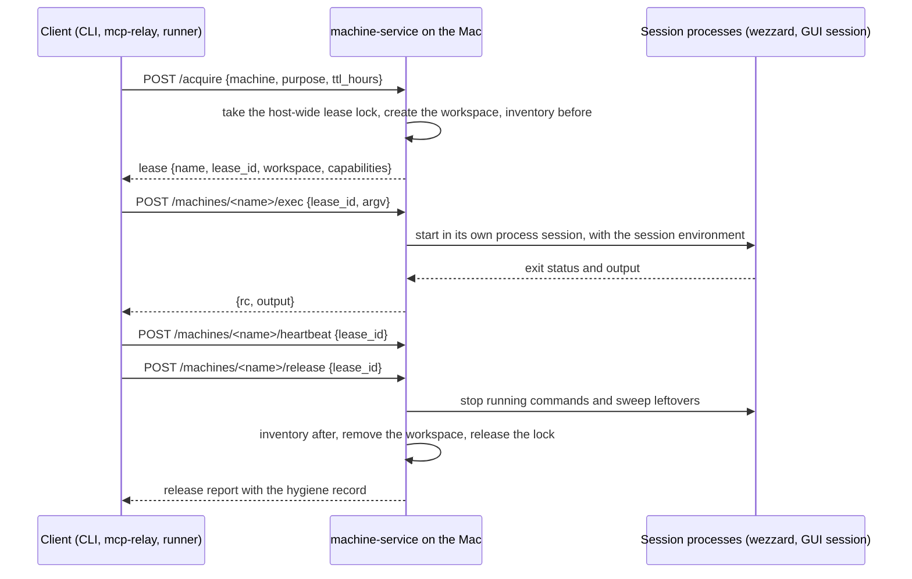

# Durable machine leases (DM)

## Why

- A durable machine is the Mac a machine-service instance runs on, when the instance's operator has turned exposure on ([MM-1](machines.md#mm-1-two-kinds-of-machine)). It cannot be cloned for a task and destroyed afterwards, so a lease on it must mean something else than a lease on a virtual machine.
- A lease on a durable machine is an **exclusive session with a scratch workspace**. The client gets the Mac for a bounded time, runs commands in its workspace, moves files in and out, and hands the Mac back.
- The session runs as the admin account `wezzard`, because software may need to be installed in the middle of a task and the environment can never be perfect (DC-23).

## DM-1: A lease is a session and a workspace

- A durable lease owns a workspace at `~/machine-service/leases/<lease_id>/` with three folders: `work/`, the default working directory; `tmp/`, the session's `TMPDIR`; and `codex/`, the session's `CODEX_HOME` ([AK-4](agent-keys.md#ak-4-codex)).
- The lease's own record lives in the service state at `~/.local/state/machine-service/leases/<lease_id>/`. It holds the lease record, the process groups the lease started, and the hygiene record ([HY](hygiene.md)).
- `HOME` stays the operator's home folder. Engine licences, installed tools, Xcode and the privacy permissions all belong to that home, and a session must be able to use them (DC-23).
- A durable lease does not isolate the session from the rest of the account. The workspace is where work is expected to happen, and hygiene records what happened elsewhere ([HY-1](hygiene.md#hy-1-best-effort-not-isolation)).

## DM-2: One lease at a time

- A durable machine admits one lease at a time (DC-26).
- The rule is enforced by a host-wide lock file, `/var/tmp/com.wezzard.machine-service/durable-machine.lock`, which every instance on the Mac uses, whatever its state directory. A second instance started for tests therefore cannot lease a Mac that the installed instance has leased.
- The lock file names its holder: the instance's state directory, the `lease_id`, the purpose and the expiry time.
- An acquisition while the machine is leased fails with HTTP 409 and the error `durable machine leased: <name> (purpose <purpose>, until <time>)`. A client that waits for capacity treats it like the virtual-machine capacity refusal ([CN-1](consumers.md#cn-1-mcp-relay)).

## DM-3: Acquire

- `POST /acquire` with `machine` set to the durable machine's name asks for a durable lease. With `image`, it asks for a virtual machine as today. A request that sets both is refused with HTTP 400.
- An instance whose exposure is off refuses every durable request with HTTP 404 and `durable machine not exposed on <instance>`, before any lock or workspace is touched.
- A durable request accepts `purpose`, `ttl_hours`, `env` and `machine`. `env` is `default`, which loads the machine's agent keys ([AK](agent-keys.md)), or `none`, which loads no keys.
- A durable request refuses `cpu`, `memory_mb`, `disk_gb`, `vnc`, `network`, `source` and `expected_source_fingerprint` with HTTP 400, because none of them can be applied to a running Mac.
- Acquisition takes the lock, creates the workspace, captures the login environment ([DM-4](#dm-4-exec)), takes the inventory before the lease ([HY-4](hygiene.md#hy-4-inventory-before-and-after)) and refreshes the expensive facts ([MM-4](machines.md#mm-4-when-facts-are-observed)). It does not wait for any boot, so it is expected to finish within a minute.
- A failure at any step releases the lock, removes the workspace and drops the record, as US-N2 requires for virtual machines.
- The response is the machine record ([MM-3](machines.md#mm-3-capability-report)) with `kind: "durable"`, the `lease_id`, the workspace path and the capabilities.

## DM-4: Exec

- `POST /machines/<name>/exec` takes `lease_id`, `argv` or `script`, and the optional `timeout` and `cwd`. Its response has the same shape as a virtual machine's exec.
- **A command is a launchd job of its own** in the GUI domain of `wezzard`'s logged-in session, whose first program is the user's shell ([RA-10](relay-agent.md#ra-10-a-command-is-a-launchd-job-on-macos), DC-310, DC-312). It is never a child of machine-service or of the relay agent, so it inherits neither's privacy permissions (DC-308). It does not go through SSH, because the service already runs on the Mac.
- **Neither machine-service nor the relay agent holds, asks for or checks a privacy permission** (DC-309). A task that needs one arranges it. GUI work goes through cua-driver, whose `cua-driver serve` LaunchAgent holds its own Screen Recording and Accessibility as `com.trycua.driver` (DC-82, [CN-3](consumers.md#cn-3-what-a-durable-machine-needs-installed)).
- **One path for every entry** (DC-219, DC-312). machine-service's own exec, `machctl`, and a relay client's `exec` or `script` through the broker take the same path: for each new execution of the lease, machine-service creates the job's FIFOs in the lease's state folder, writes the command line or the script, the session environment, the loaded agent keys and the working directory into its `env` FIFO, and gives the relay agent only the FIFOs' paths; the relay agent runs it as a job ([RA-10](relay-agent.md#ra-10-a-command-is-a-launchd-job-on-macos)). No key travels in a relay message. A client's `exec` runs through the session's `$SHELL -c`, a client's `script` through `zsh -s` fed on standard input, both in `work/`, so a command sees the same lease whatever its entry. No request file and no launcher stand between the call and the job.
- **The record, then the claim** (DC-220, DC-312). The relay agent receives a job call (`job`, [RA-5](relay-agent.md#ra-5-operations)) naming only the job's folder; a broker refuses one from a client. machine-service feeds the job's `env` in two stages. The first holds no key: the job's shell writes its PID, the leader of the job's process group. machine-service records that group with the leader's start time in the lease's state folder, and only then claims the execution by removing its claim file. The second stage then holds the session environment, the working directory and the command. A release removes every unclaimed claim first and reads the recorded groups after ([HY-3](hygiene.md#hy-3-leftover-process-sweep)), so a command either is recorded before release stops the lease's groups, or its second stage is `return 125` and it runs nothing.
- **Redaction before the agent** (DC-221, DC-312). With loaded agent keys, the job writes to a raw output FIFO that machine-service reads; machine-service replaces every key's value with `[redacted]`, a value split between two reads included, and passes the rest on to the FIFO that the relay agent reads. The job's exit report also passes through machine-service, after all the output the command wrote before it ended, so the agent never reads the end before the output. So no key reaches a relay message, the agent's records or a replay ([AK-5](agent-keys.md#ak-5-never-printed-logged-or-returned)), and the keys reach the job only through the `env` FIFO, never a file.
- **Without a relay agent** ([RA-8](relay-agent.md#ra-8-fallback)), machine-service starts the same kind of job itself and is its reader, so the fallback holds no permissions either.
- The **session environment** is built once at acquisition and reused for every command:
  1. The service runs `wezzard`'s login shell (`zsh -l -c 'env -0'`) and keeps the resulting variables, so `PATH` contains Homebrew, nvm and the other tools a person's shell has. The record keeps only the variable names.
  2. The service removes `ANTHROPIC_AUTH_TOKEN`, `CLAUDE_CODE_OAUTH_TOKEN`, `ANTHROPIC_API_KEY`, `ANTHROPIC_BASE_URL`, `OPENAI_API_KEY`, `OPENAI_BASE_URL`, `LITELLM_CODEX_KEY` and `CODEX_HOME` from it, so that no credential from the owner's own shell reaches a session.
  3. The service adds `MACHINE_SERVICE_LEASE_ID`, `MACHINE_SERVICE_WORKSPACE`, `TMPDIR` and, when `env` is `default`, the agent variables from [AK](agent-keys.md).
- An `argv` command runs through `$SHELL -c` with the arguments quoted, the way `sshd` runs a remote command and the guest session agent runs one ([GS-3](guest-session.md#gs-3-the-guest-session-agent)). A `script` is fed to `zsh -s` on standard input.
- `cwd` defaults to the workspace's `work/`, which is also where a relay client's command starts. A relative `cwd` resolves against `work/`. An absolute `cwd` may name any directory that `wezzard` can enter, because tasks may need to work in an existing project (DC-23).
- Timeouts and release preemption keep the contract of [V4](../lifecycle-fixes.md#v4-a-long-guest-operation-blocks-release-and-gc). A timeout or a cancel stops the command's job: the relay agent kills the job's process group, then boots the job out (DC-316). A release stops every recorded group of the lease and then sweeps ([HY-3](hygiene.md#hy-3-leftover-process-sweep)).
- Before the service returns output, it replaces every occurrence of a loaded agent key's value with `[redacted]` ([AK-5](agent-keys.md#ak-5-never-printed-logged-or-returned)); through the relay agent, machine-service has already done so before the agent read the output.

## DM-5: Push and pull

- On a loopback client, push and pull keep today's request: `local_path` is a path on the instance's Mac, which is the durable machine itself, so the service copies between the two paths.
- A client on another Mac cannot name a path on the instance's Mac. It uses the byte-carrying transfer of [FD-4](federation.md#fd-4-working-on-a-remote-instance), which works for both kinds of machine.
- A relative `remote_path` resolves against the workspace's `work/`. An absolute `remote_path` may name any path that `wezzard` can write (DC-23).
- A push writes to a temporary sibling and renames it into place, so a reader never sees a partial file. Both directions report the SHA-256 of what they moved.
- A file goes through the relay agent when it is available, as the agent's own write or read; a folder is copied by the service, because the relay protocol moves single files (DC-151). The answer carries `link` as for exec.

## DM-6: Heartbeat, TTL and expiry

- `POST /machines/<name>/heartbeat` with `lease_id` keeps the lease semantics of a virtual machine ([V5](../lifecycle-fixes.md#v5-a-heartbeat-without-ttl_hours)): it renews the TTL for `ttl_hours`, or for the lease's own initial TTL when it is omitted.
- The TTL defaults to 24 hours and is capped at 720 hours, as for virtual machines.
- Past its TTL a durable lease is warned. Past its TTL plus the grace period, the GC loop releases it as [DM-7](#dm-7-release) describes. The grace period is the same instance setting as for virtual machines, `MACHINE_SERVICE_GRACE_HOURS`, a number of hours, 0 or more, 6 by default.
- The lease's relay client credential ends at its TTL plus the grace bounded by its TTL ([RP-3](relay-protocol.md#rp-3-roles-and-credentials)); the Mac's agent credential is the machine's and does not end with the lease.

## DM-7: Release

- `POST /machines/<name>/release` with `lease_id` ends the session. It preempts any running exec, push or pull, as for virtual machines.
- Release then sends `SIGTERM` to every process group the lease started, waits 10 seconds, and sends `SIGKILL` to the groups that remain.
- Release then runs the sweep of leftover processes ([HY-3](hygiene.md#hy-3-leftover-process-sweep)) and takes the inventory after the lease ([HY-4](hygiene.md#hy-4-inventory-before-and-after)).
- After the sweep, release has the Mac's relay agent purge the lease's execution records, whose kept output may hold agent keys unredacted ([AK-5](agent-keys.md#ak-5-never-printed-logged-or-returned)), and waits up to 60 seconds for its confirmation. The hygiene record's `relay_records` says `purged` with the counts, or why the purge was skipped or failed; an unconfirmed purge is the failure of the step `relay-records` ([RP-14](relay-protocol.md#rp-14-records-belong-to-their-lease), DC-173).
- An unconfirmed purge stays pending: release stores it in `<state>/relay-purges.json` together with the hygiene record, before the lease is marked released, and its `relay_records` says `pending`. The service sends every pending purge again each time the Mac's relay agent registers, and at startup when the agent already has a session, until the agent confirms it. A confirmed purge leaves the list and is never sent again; the lease's hygiene record then says `purged` with `purged_at`, `pending_since` and `attempts`, and keeps the `relay-records` failure of the release. The machine record and `/health` list the pending purges as `relay_purges_pending`, with each lease, since when, the attempts and the last reason (DC-177).
- Release removes the workspace, unless the request sets `keep_workspace: true`. A kept workspace is listed in the lease record and removed by GC after 7 days.
- Release returns the hygiene record and keeps the lease record for 30 days, so a client can read what happened after the lease ended.
- Release never reboots the Mac, logs a user out, uninstalls software or reverts a change outside the workspace. Those changes are recorded, not undone ([HY-1](hygiene.md#hy-1-best-effort-not-isolation)).
- A failure in the sweep or the inventory is recorded in the release report. It never keeps the machine leased.

## DM-8: Service restart

- A restart of machine-service does not end a durable lease, because the Mac and the session's processes are still there.
- The service attaches its relay link before it reconciles the durable lease, so a release that the restart interrupted purges the relay agent's records through the broker. Pending purges are on disk and survive the restart ([DM-7](#dm-7-release), DC-177).
- Session processes run in their own process sessions, so launchd does not kill them when the service's job stops. At startup the service reads the recorded process groups of the current lease and signals them at release as usual.
- An exec, push or pull in flight at the restart has no outcome the service can report. Its client receives a connection failure, and a query of its execution ID over a remote session answers `unknown`, as [AC-14](../acceptance/orchestrator.acceptance) requires.

## DM-9: What a durable lease does not offer

- A durable machine is on the home network. It reaches the host services, the private networks and the internet. It reports `network: "lan"` in its capabilities, and the `internet` network of DC-13 does not apply to it. A task that must not reach the home network must use a virtual machine with `network: "internet"`.
- A durable lease has no console operations. The owner views a durable machine with Screen Sharing directly, outside machine-service.
- A durable lease does not inject the credential packs of `~/.config/vm-credentials/`. Its only credentials are the agent keys of [AK](agent-keys.md).
