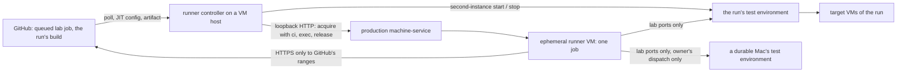

# Lab runners (LR)

## Why

- This repository is public. A self-hosted runner that serves a public repository runs whatever a workflow says, so GitHub's own guidance is a fresh, isolated, single-use machine per job, not a long-lived runner on a machine that matters (DC-259).
- The relay acceptance (TL-7) checks machine-service itself, so it must run the branch's new code, and it is destructive on purpose: it cuts connections, restarts the broker and stops agents. It cannot run against the machine-service the owner uses every day.
- The first design (DC-260) ran one long-lived extra machine-service on every lab Mac for two unrelated jobs: lending the runner VMs, and being the code under test. Those need different lifetimes. The long-lived copy kept testing whatever build it started with, and on the durable Macs it was an always-open door to the LAN: machine-service has no login, so any device on the network could have leased the Mac through it. The owner revised the design (DC-284):
  - **Production lends the ephemeral runner VMs.** Lending a disposable VM is its everyday job.
  - **The code under test runs as a test environment started fresh for each run** from that run's own build, on the host that serves the run, and removed after the run.
  - **No long-lived extra machine-service runs on any Mac**, and none on a durable Mac except during a run the owner starts by hand.

| Part | What it is | Name here |
| --- | --- | --- |
| The VM that runs one CI job | a VM with a one-job GitHub runner in it, deleted after the job | **ephemeral runner** (GitHub: just-in-time runner) |
| The program that makes them | sees a queued job, has a VM lent, starts the runner, gives the VM back | **runner controller**, the `lab-host` executable |
| The machine-service under test | a second instance (TL-4) of the run's own build, for that run only | **test environment** |
| The installed machine-service | what the owner uses every day | **production** |



## LR-1: Roles

- The **runner controller** is one executable, `lab-host`, from the crate `lab-runners`, run by one per-user LaunchAgent, `com.wezzard.vm-service.lab`. It runs no machine-service of its own.
  - On a **VM host** it serves queued lab jobs with ephemeral runners (LR-3), runs the test environment of each run it serves (LR-6) and keeps the egress allowlist current (LR-5).
  - On a **durable Mac** it is installed only if the owner chooses, and then only starts that Mac's test environment for a run the owner dispatched by hand (LR-10). By default nothing of the lab runs on a durable Mac.
  - Its role is what production's `/health` shows: a Mac whose production exposes it as a durable machine is a durable Mac.
- **Production** is the Mac's installed machine-service on its usual port, which the controller reaches on loopback only (`http://127.0.0.1:6240`). It lends every ephemeral runner, with the `ci` credential pack (LR-12), and is never restarted, reconfigured or tested by the lab. The controller gives back only the leases it took, whose purpose is `lab-<job>` and whose record shows the pack `ci`.
- An **ephemeral runner** is a VM of production's `macos26` or `ubuntu2404` image, leased with the network `internet` and the egress `allowlist` (LR-5), for one job. Its JIT runner runs in the guest's desktop session as a child of the relay agent (RA-2), started through production's HTTP exec, which takes the relay link (BK-3).
- A **test environment** is a second instance (TL-4, DC-243) of the run's own build, started by the build's `second-instance` launcher with its own ports, state, configuration, credential packs and VM prefix `si-r<run>-`, and the second-instance mark in `/health` (DC-244), for the run's duration only (LR-6).
- `lab-host` is the LaunchAgent's own program, so macOS's local network privacy attributes every LAN connection that it, the launcher and the test environments make to `lab-host`, and one grant per Mac covers the lab (DC-271).

## LR-2: Where jobs come from

- GitHub's runner scale-set client (`actions/scaleset`, public preview since 2026-02) was checked and not chosen, for now (DC-265): it documents a GitHub App or a personal access token, not a fine-grained token (LR-4); it is a Go module, while the lab is Rust under `cargo test`'s isolation rules (DC-251 to DC-258), and the protocol under it is not a documented REST API; and a scale set's name is its job's only label.
- The controller reads jobs from the documented REST API behind one interface, `JobSource`, so a scale-set source can replace it:
  - Every 15 seconds: `GET /repos/{owner}/{repo}/actions/runs?status=queued` and `?status=in_progress`, since a run with one job started still has queued jobs; keeps the runs it serves (LR-11); then `GET .../actions/runs/{run}/jobs?filter=latest` for each, keeping the jobs with status `queued` whose labels are a lab set (LR-3). No webhook reaches the lab, because nothing may listen for GitHub on the home network.
  - `POST .../actions/runners/generate-jitconfig` with the name `lab-<host tag>-<job id>`, the runner group 1 and exactly the job's labels.
  - `GET .../actions/runners`: a lab runner that is registered and not yet busy is **pending**, and a queued job that a pending runner can take is not provisioned again, so the two VM hosts do not both start a runner for one job. When both see a job in the same instant, one runner stays idle; the idle limit of LR-3 removes it.
  - `DELETE .../actions/runners/{id}` removes a runner whose VM ended before its job did.
  - `GET .../actions/runs/{run}/artifacts?name=lab-test-environment` and `GET .../actions/artifacts/{id}/zip` fetch the run's build (LR-6).

## LR-3: A job's life

- A lab job's `runs-on` is `[self-hosted, lab-macos]` or `[self-hosted, lab-ubuntu]`, the runner VM's image, and may add one of `lab-macos-target`, a job that will lease one macOS VM of its run's test environment on this host, or `lab-durable-target`, a durable cell, whose target is a durable Mac's test environment (LR-10). No other label is served, and no lab label is ever given to a runner outside an ephemeral runner (DC-266).
- For each queued job of a run it serves, the controller, in order:
  1. Checks capacity (LR-7). Without room the job stays queued; nothing is fetched or leased early.
  2. Has its target up. For a VM cell: the run's test environment on this host, started from the run's verified build when it is not up yet (LR-6). For a durable cell: a durable Mac's test environment of the same run, found by asking `/health` on port 6272 of every instance discovery lists (`machctl list --json`). Without its target the job stays queued, and the log says why once in a while.
  3. Writes the lab table (LR-5) with the addresses its runners reach, before the acquisition, because production hands that table to Softnet when it starts the VM.
  4. Acquires an ephemeral runner from production on loopback: the job's image, the network `internet` with the egress `allowlist`, the purpose `lab-<job id>`, **`env: "ci"`** (LR-12), and a TTL of 7 hours, past GitHub's 6-hour job limit. The acquisition is `running` only after the guest firewall has its address and the isolation check proved the fence (LR-5).
  5. **Checks the lease record's pack.** A record that does not show `ci` gets no runner: the controller releases the VM at once and logs why. A request alone proves nothing on an API without authentication (DC-283, FD-5). A production that has no `ci` pack refuses the acquisition (LR-12), and the job stays queued.
  6. Places the pinned runner archive in the guest (LR-8), with the byte-carrying file endpoint and its SHA-256 (FD-4), under `/tmp/lab-runner/`, and writes the job's plan, `lab-plan.json`: the run, the job, the run's test environments with their names, addresses and ports, `vm_target` (this host's, for a VM cell) and `durable_targets` (for a durable cell). It adds the test environments' names to the guest's `/etc/hosts`. **This is how a run learns where its test environment is: inside its runner VM, never in a log.**
  7. Generates the JIT config and writes it into the guest as a file only the guest user can read; the start script reads it into `ACTIONS_RUNNER_INPUT_JITCONFIG` and removes it before the runner starts, so it is in no command line, no execution record and no log.
  8. Starts the runner with one exec whose timeout is the deadline, 6 hours 30 minutes after the start. The runner takes the job, runs it and exits.
  9. Releases the VM: on the runner's exit, at the deadline, when the runner has not taken a job within 10 minutes, and when `lab-host` stops. Release deletes the clone. A registration the runner left is deleted.
- Each job is one thread, and the controller keeps its jobs in `~/.local/state/vm-service-lab/jobs/<job id>.json`. When `lab-host` starts again, it releases every lease of production whose purpose is `lab-<job id>` and whose record shows `ci` and that it no longer drives, deletes the job's runner if it is still registered, and stops every test environment it finds (LR-6), so a crash leaves nothing behind.
- The controller logs the job ID, the run ID, the VM's name and the lease's state; never the token, the JIT config, a test environment's address or port, or a host name, because its log is the operator's and its errors may be quoted.

## LR-4: The token

- A VM host's controller needs one fine-grained personal access token: **Repository access** only `WeZZard/vm-service`; **Permissions**: Administration read and write (self-hosted runners, JIT configs), Actions read (runs, jobs and **artifacts**, LR-6), Metadata read (always on). Nothing else (DC-261).
- A durable Mac's controller needs only Actions read and Metadata read: it registers no runner and leases nothing (LR-10). Its owner gives it a token with no Administration permission.
- It lives in the Mac's login keychain as a generic password, service `com.wezzard.vm-service.lab.github-token`, account `WeZZard/vm-service`. The owner stores it once per Mac, at the Mac, in a terminal of the desktop session:

  ```sh
  security add-generic-password -U -a WeZZard/vm-service -s com.wezzard.vm-service.lab.github-token -w
  ```

  The trailing `-w` without a value makes `security` prompt for the token twice, so it is never in an argument, the shell's history or a file. `-U` replaces an earlier token, which is also how it is rotated.
- `lab-host` reads it with `/usr/bin/security find-generic-password ... -w`, by absolute path (DC-239, DC-242), into memory, for each round, so a rotated token takes effect without a restart.
- Without the item the controller serves nothing and logs, once an hour, the command above. `lab-host doctor` prints the same check, and never the token.
- The token never enters a VM, a test environment, a file, a log or the repository. A runner VM receives only its single-use JIT config. An artifact is downloaded with the token from GitHub's API and fetched from the storage URL GitHub redirects to without it. A workflow uses no secret and its `GITHUB_TOKEN` has `contents: read` (LR-9).

## LR-5: The egress allowlist

- The owner limited a runner VM's network to GitHub and the lab's test endpoints (DC-262). A runner VM is an `internet` guest (DC-13): Softnet keeps it on its own address and MAC address and off the private networks, and the guest firewall keeps it off its host (DC-14, DC-15). A job has root in its guest, so every rule of the fence is enforced on the host, never in the guest.
- An acquisition that asks for `egress: "allowlist"` (network `internet` only) makes the guest an **egress guest** (DC-267). The guest firewall's anchor has an egress section that applies only to the addresses in its egress table:
  - The host's connections to its egress guests keep state, and their DHCP reaches `bootpd`.
  - An egress guest may open TCP to this host's own addresses on production's broker port (6241), whose relay agent link it dials, since production lends it (DC-107), and on the lab ports, 6272 and 6273, where the run's test environment listens.
  - It may open TCP to the addresses in the **lab table** on the lab ports only: the durable Macs whose test environment a running job reaches.
  - It may open TCP to the addresses in the **allow table** on ports 443 and 853 only: GitHub, and the guest's DNS-over-TLS resolvers.
  - Everything else it sends is dropped: every other port of its host and of the lab hosts, the rest of the LAN, other guests, plain DNS and every other public address.
- The tables are files beside the `internet` table, in `/var/db/com.wezzard.vm-service/`, which the operator's account owns: `egress-guests` (production adds and removes its egress guests), `egress-allow` and `egress-lab` (both written by `lab-host`). The guest firewall's LaunchDaemon reloads the anchor whenever a file there changes, so a refreshed list needs no root and no restart of any VM.
- The lab table holds this host's LAN address and the addresses of the durable Macs that a running job of this host reaches. It is written before an acquisition and after a job ends, never with fewer addresses than a running job needs.
- Softnet drops private destinations, so production passes the lab table's addresses to Softnet for an egress guest (`--net-softnet-allow=<address>/32,...`); the anchor then limits them to the lab ports.
- `lab-host` writes the allow table every 30 minutes, atomically, and only from a complete refresh; a failed refresh keeps the last list. It holds the IPv4 ranges of `web`, `api`, `git` and `packages` of `https://api.github.com/meta`; every IPv4 address that the `domains.actions_inbound.full_domains` of the same answer resolve to; the guests' DNS-over-TLS resolvers (DC-16); and a comment line `# check: api.github.com` naming what the isolation check loads.
- **The home network's DNS proxy** answers some names with fake `198.18.x.x` addresses. `lab-host` resolves every name over DNS over TLS to the guests' own public resolvers and refuses any answer that is not globally routable; the guests resolve the same way (DC-268). Test environments are reached by the Macs' `.local` names, which `lab-host` writes into the guest's `/etc/hosts` with their real addresses.
- The isolation check of an egress guest, before it is `running`, keeps DC-14's probe and adds two: the allow file's check name resolves and loads over HTTPS, and `example.com` does not load. A guest that fails is never handed to a job.
- Every lab address is off the guest's own subnet, reached through its default gateway, so macOS in the guest never asks for local network access (DC-269).
- The anchor's egress section is part of every installation of the guest firewall from this branch. A host whose installed anchor has no egress section refuses an egress acquisition with the install command, before anything is cloned, and `lab-host doctor` says so.

## LR-6: The test environment of a run

- **What runs.** The run's own build: the workflow's `environment` job builds an installation of the commit (`build-release.sh`) and the `second-instance` launcher on a GitHub-hosted runner, packs them as `test-environment.tar.gz` and writes `test-environment.json`, `{"run_id", "head_sha", "archive", "sha256"}`, beside it, and uploads both as the run's artifact `lab-test-environment` (LR-9). Nothing is built on a lab Mac.
- **When.** A VM host's controller starts the run's test environment when it is about to start a VM cell of the run (LR-3) and none runs yet. A durable Mac's starts its own only for a run the owner dispatched (LR-10). A host runs one test environment at a time, because it holds the lab ports; a job of another run waits, and the workflow runs one lab run at a time anyway (LR-9).
- **Fetching and verifying.** The controller, with `actions: read`:
  1. finds the run's artifact `lab-test-environment` that has not expired, and downloads its zip, following GitHub's redirect to its storage without the token;
  2. checks that GitHub says the artifact is this run's (`workflow_run.id`) and of the run's commit (`workflow_run.head_sha` against the run's `head_sha`), and, when GitHub reports a `digest`, that the zip's SHA-256 matches it;
  3. unpacks the zip with macOS's `tar` into the run's folder, and checks that the manifest names this run and its commit and that `test-environment.tar.gz` has the SHA-256 the manifest records;
  4. unpacks the archive into `bundle/`, which must hold `machine-service` and `second-instance`. macOS's `tar` refuses members with `..` or an absolute path.
  A build that fails any check is refused: nothing starts, the run's folder is removed, and its jobs stay queued.
- **Starting.** The build's own launcher runs `second-instance start --root <state>/runs/<run>/env --id r<run> --port 6272 --session-port 6273 --bind <the host's LAN address> --tart-home ~/.tart --executable <bundle>/machine-service --guest-link relay`, with `MACHINE_SERVICE_RELAY_GUEST_URL` naming its broker on that address, `MACHINE_SERVICE_GRACE_HOURS=0`, `PILOT_REPO` read from production's LaunchAgent at run time, and, on a durable Mac, `--durable --durable-cell macos-client.durable-mac,ubuntu-client.durable-mac` (DC-273). Both listeners bind the one LAN address, never every interface (DC-244); the runner VMs reach it through their gateway. A Mac without a Tart store gives it an empty one in the run's folder. The controller waits until `/health` answers with `second_instance.id` `r<run>`.
- **Credentials.** A test environment reads credential packs only from its own `<root>/config/vm-credentials`, which the launcher makes empty, so its VMs never get production's `default` or `ci` (DC-247, DC-283). The relay acceptance asks for `env: "none"`.
- **The relay agent release.** A build holds the ad hoc relay agent pre-release its commit builds. When the controller's bundle holds a published release, `relay-agent-release/` (`lab-host.sh install --relay-agent-release DIR`), it replaces the build's, checked against its `SHA256SUMS` before and after the copy, so an image whose agent is signed with Developer ID is never asked to downgrade it (DC-232, DC-274).
- **Telling the run.** Only through the plan in its runner VMs (LR-3, step 6). No log, artifact or job output names a test environment's address or port, and the first step of every lab job masks every name and address of the plan.
- **Stopping.** After the run: a VM host stops its test environment once GitHub no longer lists the run as queued or in progress and no job of the run is still its own; a durable Mac once the run has no durable cell left (LR-10). Either stops it at the latest after `LIFETIME`, two job deadlines (13 hours), whatever the run does. `second-instance stop --root <run>/env` releases every lease, deletes every `si-r<run>-` VM, unloads its relay agent and removes its root, working from its manifest alone (DC-243); then the run's folder is removed. A stop that fails keeps the folder, and the next round tries again.
- **After a crash.** Every test environment lies in `~/.local/state/vm-service-lab/runs/<run>/`, with the launcher's manifest and the build's own launcher. A restarted controller takes over nothing: it stops every test environment it finds from its manifest, with the build's launcher, or its own when the build's is gone, and removes the folder; a folder with no manifest held nothing yet and is removed. `lab-host.sh remove` does the same.

## LR-7: Capacity

- A VM host runs at most two macOS guests, whoever started them (DC-18). The controller counts every slot and queues rather than oversubscribe (DC-264). Production's `GET /images` reports `capacity.macos_taken`, which counts every macOS guest on the host: production's, the test environment's and any other program's.
- A job needs one macOS slot for a `lab-macos` runner, none for `lab-ubuntu`, and one more with `lab-macos-target`; a durable cell needs only its runner's. The controller starts a job only when `macos_limit - macos_taken - (slots its own starting jobs will take)` covers it.
- While another program's macOS guest runs on the host, the controller starts nothing that needs a macOS slot, so the lab yields to an image build. Production counts the test environment's guests as another program's; the controller takes the test environment's own running macOS guests out of that count (`decide::without_test_environment`), so the lab never waits for its own targets.
- Between the check and the job's own acquisition another program can still take the slot; the job's acquisition then fails with the capacity refusal and the run says so.

## LR-8: The runner

- The runner is installed at lease time, not in the image (DC-272): actions/runner 2.338.2, whose archives' SHA-256 values are pinned in `lab-runners`. `lab-host` downloads each once into `~/.local/state/vm-service-lab/cache/`, checks it against the pin before every use, pushes it into the guest with its SHA-256 (FD-4), and the guest checks it again before it unpacks it.
- A JIT runner cannot be configured with `--disableupdate`. An update it applies happens inside its one-job VM and vanishes with it. The pin is raised deliberately when GitHub asks.
- The runner starts in the guest's desktop session as a child of the relay agent, with `HOME` the guest user's, its work folder `~/actions-runner/_work`, and the plan's path as `LAB_PLAN` in the runner's `.env`.

## LR-9: The workflow

- `.github/workflows/lab.yml` runs the relay acceptance (TL-7) on the lab's ephemeral runners. Its `GITHUB_TOKEN` has `permissions: contents: read`, it uses no secret, and its checkout keeps no credential.
- **Plan** turns the inputs into the cells' matrices, with each cell's labels. **Build** builds `relay-acceptance` and fills the network rig's tool cache on GitHub-hosted runners (`macos-15`; `ubuntu-24.04-arm`, static musl). **Environment** builds the run's test environment on `macos-15` and uploads it as `lab-test-environment` with its manifest, kept one day (LR-6). The cells need all three, so a cell is queued only when its run's build exists. A runner VM reaches only GitHub and its test environments, so it builds nothing and fetches no crate.
- **VM cells** run on a push to `claude/relay-agent` of this repository and on a dispatch: `macos-client.macos-vm`, `macos-client.ubuntu-vm`, `ubuntu-client.macos-vm` and `ubuntu-client.ubuntu-vm`, with the labels of LR-3. Each downloads the client, reads `LAB_PLAN`, and runs the cell (`rust/scripts/lab-cell.sh`) against `vm_target` with `--agent-rig external`, without host control.
- **Durable cells** run only on a dispatch by the owner (`workflow_dispatch` with `durable: true` and `github.actor` the repository's owner), never on a push (DC-263). Their labels carry `lab-durable-target`, and their target is `durable_targets` of the plan. The workflow's own condition is a convenience; what admits a durable Mac is its controller's check of the run against its local owner login (LR-10).
- Concurrency: one lab run at a time, whatever its ref (`group: lab`, never cancelled), and the durable cells in their own group, `lab-durable`, one at a time.
- Every job ends with an always-run cleanup that releases every lease of its run's test environments whose purpose carries the run's ID. The runner VM is its controller's to release, and stopping a test environment releases whatever is left.
- The first step masks every name and address of `LAB_PLAN`, and every later step's output and the uploaded evidence are redacted with them (relay-lab entry LAB-8).

## LR-10: Durable Macs

- No test environment and no controller runs on a durable Mac by default. Durable cells run only on a run the owner dispatches by hand, and a durable Mac's test environment exists only for that run's duration.
- **The mechanism: a durable Mac's own controller that polls and never listens.** The owner may install the runner controller on a durable Mac (`lab-host.sh install --owner LOGIN`). There it is only this loop, every 30 seconds:
  1. Read the repository's queued and in-progress runs from GitHub's API, outbound HTTPS with a token that has Actions read only (LR-4).
  2. Keep a run only when GitHub reports that it is of `.github/workflows/lab.yml`, from the repository itself, with `event` `workflow_dispatch`, and with both `actor` and `triggering_actor` the **owner login of the Mac's local configuration**, `~/.config/vm-service-lab/controller.json` (`{"owner": "<login>"}`), never a value from the repository or the run's inputs (LR-11). Without that file the controller serves nothing and says so.
  3. Of those, serve the oldest run that still has a job labelled `lab-durable-target` that has not ended.
  4. Start that run's test environment from its verified build (LR-6) with durable exposure for the durable cells, bound to the Mac's LAN address on the two lab ports; stop and remove it as soon as the run has no durable job left, the run ends, or its lifetime passes.
- **What stands, and what is open.** The only standing piece is a process that dials GitHub; it has no listener, no port and no inbound path, so nothing on the LAN can ask it to do anything. The only door is the test environment's HTTP API and broker, on the lab ports, and only while a run the owner dispatched has a durable cell left. The VM hosts' runner VMs reach it there through their guest firewall (LR-5). Everything else of the test environment, its discovery among them, stays on loopback or off (DC-244).
- **Why it is safe enough.** Starting the test environment needs the owner's own act: a dispatch, which GitHub attributes to the account that made it, checked against a login only the owner can write on the Mac. A push, a pull request, a schedule, someone else's dispatch, and the owner's run re-run by someone else start nothing. What a run gets on the Mac is what a durable cell needs, for at most its lifetime.
- **Alternatives, and why not:**
  - *A VM host's controller starts it over SSH*: SSH from the lab into the owner's Mac is the standing door the revision removes.
  - *A VM host's controller starts it through production's durable lease of the Mac*: production would lend the whole Mac, as the owner, to a program driven by CI; it is the same door, opened by the lab.
  - *A small listener on the durable Mac that the VM host asks* (an HTTP endpoint, or a launchd socket that starts a process on demand): a permanent LAN-reachable door, even if its process is short-lived.
  - *A self-hosted runner on the durable Mac for durable runs*: it runs workflow code as the owner on the real Mac, the thing DC-259 removed.
  - *Polling GitHub without a token*: GitHub allows 60 unauthenticated requests an hour per address, shared by every Mac behind the home network's one public address; too few for a poll every 30 seconds.
  - *The owner starts the test environment by hand before each dispatch*: no standing piece at all, but a manual step for every run, which is easy to forget to undo; the owner asked for a dispatch-only flow.
- **What it costs.** A token with Actions read on each durable Mac that takes part, one local network grant for `lab-host` there, and a LaunchAgent the owner loads. Both durable Macs may take part; each then runs a test environment for the same run, and the durable cells use the first one in the plan.

## LR-11: Which runs are served

- A VM host serves only runs that GitHub reports as of `.github/workflows/lab.yml`, started by `push` or `workflow_dispatch`, from `WeZZard/vm-service` itself (`head_repository`). A pull request's run, a fork's above all, and any other workflow's run, get no runner VM and no test environment, whatever labels their jobs ask for: a test environment runs the run's own build on the host, outside any VM.
- A durable Mac serves only runs that also meet LR-10's dispatch check.
- Both read these facts from GitHub's API about the run, never from the repository's files or the run's inputs.

## LR-12: Credentials

- Each environment gets its own credentials (DC-283):
  - VMs for agent runs keep the agent pack, `default`.
  - An ephemeral runner gets only the `ci` pack, never the agent pack. The controller names it in every acquisition and refuses to start a runner unless the lease record shows `ci` (LR-3).
  - VMs a test environment creates get only that test environment's own packs (DC-247), which are empty.
- **Where `ci` lives.** Production's packs folder, `~/.config/vm-credentials/ci/`. `machine-service-install install` creates it empty, mode 700, when it is missing, and never changes it when it is there. It ships empty: a runner VM gets nothing from it.
- **Adding a CI need.** The owner puts the file into `~/.config/vm-credentials/ci/` by hand, as for any pack (`env.extra`, `git-identity`, `home.tgz`), on every VM host, and records the need and its reason as a decision first. Nothing in the repository or a workflow can add to it, and a secret placed there reaches every lab job, whose code is the repository's, so only what a public CI job may hold belongs there.
- **No fallback.** Production resolves a named pack in its own packs folder or refuses the acquisition before anything is cloned: a request for `ci` on a host without it is refused, never served with `default`. A pack name is a plain folder name, so it never names a folder outside the packs folder. Only a request that names no pack at all gets `default`, as before.

## Installation and updates

- `rust/scripts/lab-host.sh install [--owner LOGIN] [--relay-agent-release DIR] [--sign-developer-id]` builds this checkout's `lab-host`, `second-instance`, `machctl` and guest firewall installer, copies them to `~/.local/libexec/vm-service-lab/<commit>/`, points `current` at it, writes the LaunchAgent and prints the one command that loads it. `--owner` writes the durable Mac's local configuration (LR-10). Running it again from a newer checkout is the update; a running `lab-host` exits when it serves no job and runs no test environment, and launchd starts the new one. `lab-host.sh remove` unloads the LaunchAgent, stops every test environment from its manifest and removes the bundles.
- `lab-host` is signed ad hoc like every build, so its local network grant names its exact build, and every update asks again, unless the owner signs it with the Developer ID identity under `com.wezzard.vm-service.lab` (DC-271).
- Production must be a build with DC-267's egress acquisitions and DC-283's pack refusal; the guest firewall's anchor must be installed from this branch, so that it has the egress section with production's broker port.
- The owner's steps, once per Mac:
  - On each VM host: install production from a build of this branch (`machine-service-install install`, which also creates the empty `ci` pack); install the guest firewall's anchor (`sudo <bundle>/vm-service-guest-firewall install`); store the token with Administration read and write and Actions read (LR-4); run `lab-host.sh install` and load the LaunchAgent; allow `lab-host` on the Local Network prompt; check with `lab-host doctor`.
  - On a durable Mac, only if it takes part in durable cells: store a token with Actions read only; run `lab-host.sh install --owner <your login>` and load the LaunchAgent; allow `lab-host` on the Local Network prompt; check with `lab-host doctor`.

## Tests

- TL-1: the controller's decisions as functions over values: which queued jobs are served, the label sets (the durable target among them), pending runners, capacity with and without foreign guests and without the test environment's own, the deadline and the idle limit, the plan; which runs are served and which a durable Mac serves (`runs`): event, workflow, repository, actor and triggering actor against the configured owner; the build's verification (`environment::verify`): the run and commit GitHub reports, its digest, the manifest's run, commit and archive SHA-256; the test environment's start arguments; the `ci` check of a lease record; the local configuration; the allowlist's assembly; the token's missing-item message; the anchor's egress section, checked by `pfctl -n`.
- TL-2, the real `lab-host` binary against a fake GitHub, a fake production and fake test environments on loopback, through the test build's seams (`LAB_HOST_TEST_SEAMS`, DC-251), with a run's build a real zip of a real archive whose `second-instance` is a fake launcher that records its arguments:
  - one queued job: the run's build is downloaded (its storage without the token), verified and started as the run's test environment on the host's address and the lab ports; production lends one runner VM with `ci`; the runner, its plan naming the test environment, the hosts file and the JIT config are placed; the VM is released and the runner removed; the test environment is stopped and its folder removed once the run ended;
  - a lease whose record shows `default` or no pack gets no runner and is released at once; production's refusal of a missing `ci` pack leaves the job queued;
  - a build with a changed archive, a manifest of another run, or a download that does not match GitHub's digest starts nothing and leaves no folder;
  - a pull request's run is never served; a job without room stays queued and fetches nothing; without the token nothing is served and the log says how to store it;
  - after a crash: the runner VM an earlier controller left is released, production's other leases are not, and a test environment it left is stopped from its manifest with the build's own launcher and removed;
  - a durable cell waits until a durable Mac's test environment of its run answers, then reaches it through its plan, and the VM host starts none of its own;
  - a durable Mac starts its test environment, with durable exposure, only for the owner's dispatch, never for the owner's push or another login's dispatch, and stops it once the run ended; without an owner login it serves nothing and reaches nothing.
- Production: a request for `ci` on a host without it is refused before any clone and never served with `default`; with an empty `ci` the lease records `ci` and no pack file reaches the guest (`machine-service` integration); a pack name never leaves the packs folder (`machine-service-core`); the installer creates `ci` empty, mode 700, and keeps one that is there with its files (`machine-service-install`).
- Nothing in the default `cargo test` reaches GitHub, production, a test environment, the keychain or the account's home.
- Live, not yet run: one dispatched run with VM cells and durable cells; the runner VMs deleted, the test environments gone from every Mac afterwards, and from inside a runner a refused LAN probe, a refused `example.com` and a reached `api.github.com`.
