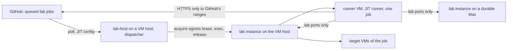

# Lab runners (LR)

## Why

- This repository is public. A self-hosted runner that serves a public repository runs whatever a workflow says, so GitHub's own guidance is a fresh, isolated, single-use machine per job, not a long-lived runner on a machine that matters.
- The lab runners of DC-1xx-LAB-1 were long-lived runners on the durable Macs, the owner's own machines, as the owner's account. A job could leave anything behind, and every job reached the whole LAN.
- The owner decided that lab jobs run in ephemeral virtual machines leased from machine-service on the VM hosts, 192.0.2.3 and 192.0.2.6: one fresh VM per job, a just-in-time (JIT) runner for exactly one job inside it, a network limited to GitHub and the lab's test endpoints, and the VM deleted afterwards. The durable Macs, 192.0.2.4 and 192.0.2.5, run no runner and are only targets (DC-259).
- Each job used to start a second instance on its targets over SSH. A long-lived lab instance on every host replaces that setup, so no job sets up a host and no SSH remains in the lab (DC-260).



## LR-1: Roles

- **`lab-host`** is one executable, from the crate `lab-runners`, and one per-user LaunchAgent, `com.wezzard.vm-service.lab`, on every lab host. It keeps the host's lab instance running (LR-6). On a VM host it is also the **dispatcher** (LR-3) and keeps the egress allowlist current (LR-5).
- A **lab instance** is a second instance (TL-4, DC-243) started by the `second-instance` launcher under `~/.local/state/vm-service-lab/instance`, with the instance ID `lab`, its own ports, state, configuration and credential packs, the clone prefix `si-lab-`, and the second-instance mark in `/health` (DC-244). Every lab host runs one: the VM hosts with Tart, the durable Macs with durable exposure on.
- The **installed instance** of each Mac is never used, restarted or changed by the lab. Every lease of the lab, runner VMs and the jobs' targets alike, comes from a lab instance.
- A **runner VM** is a VM of a lab instance's `macos26` or `ubuntu2404` image, leased with the network `internet` and the egress `allowlist` (LR-5), for one job. Its JIT runner runs in the guest's desktop session as a child of the relay agent (RA-2), started through the lab instance's HTTP exec, which takes the relay link (BK-3).
- `lab-host` is the LaunchAgent's own program, so macOS's local network privacy attributes every LAN connection that it, the launcher, the lab instance and their tools make to `lab-host`, and one grant per Mac covers the lab (LR-6, DC-1xx-LAB-14).

## LR-2: Where jobs come from

- GitHub's runner scale-set client (`actions/scaleset`, public preview since 2026-02) does serve hosts outside Kubernetes, macOS included: it long-polls GitHub for a scale set's assigned jobs and generates JIT configs, and leaves provisioning to its caller. It was checked and not chosen, for now (DC-265):
  - It authenticates with a GitHub App or a personal access token; the owner's decision is a fine-grained token limited to this repository's runner administration (LR-4), which its documentation does not cover.
  - It is a Go module. The lab is Rust, built and tested by `cargo test` under the isolation rules of DC-251 to DC-258; the protocol under it is not a documented REST API, so a Rust copy would track a private protocol.
  - Its scale set's name is the label a job targets, so the per-image and per-capacity labels of LR-3 would become one scale set each.
- The dispatcher reads jobs from the documented REST API behind one interface, `JobSource`, so a scale-set source can replace it without touching the rest:
  - Every 15 seconds: `GET /repos/{owner}/{repo}/actions/runs?status=queued`, then `GET /repos/{owner}/{repo}/actions/runs/{run}/jobs?filter=latest` for each run, keeping jobs with status `queued` whose labels are a lab set (LR-3). No webhook reaches the lab, because nothing may listen for GitHub on the home network.
  - `POST /repos/{owner}/{repo}/actions/runners/generate-jitconfig` with the name `lab-<host tag>-<job id>`, the runner group 1 (the repository's default) and exactly the job's labels; its `encoded_jit_config` starts one runner for one job, and the runner deregisters itself when the job ends.
  - `GET /repos/{owner}/{repo}/actions/runners` lists the lab's registered runners: one that is registered and not yet busy is **pending**, and a queued job that a pending runner can take is not provisioned again, so the two VM hosts' dispatchers do not both start a runner for one job. When both see a job in the same instant, one runner stays idle; the deadline of LR-3 removes it.
  - `DELETE /repos/{owner}/{repo}/actions/runners/{id}` removes a runner whose VM ended before its job did.

## LR-3: A job's life

- A lab job's `runs-on` is `[self-hosted, lab-macos]` or `[self-hosted, lab-ubuntu]`, the runner VM's image, and may add `lab-macos-target`, a job that will lease one macOS VM of its host's lab instance as its target. No other label is served, and no lab label is ever given to a runner outside a runner VM (DC-266).
- For each queued job it serves, the dispatcher, in order:
  1. Checks capacity (LR-7). Without room the job stays queued and is looked at again next round; nothing is leased early.
  2. Acquires a runner VM from its own host's lab instance: the job's image, the network `internet` with the egress `allowlist`, the purpose `lab-<job id>`, `env: none` (no credential pack), and a TTL of 7 hours, past GitHub's 6-hour job limit. The acquisition is `running` only after the guest firewall has its address and the isolation check proved the fence (LR-5).
  3. Places the pinned runner archive in the guest (LR-8), with the byte-carrying file endpoint and its SHA-256 (FD-4), under `/tmp/lab-runner/`, and writes the job's plan, `lab-plan.json`: the lab instances its job may use, each with its name, address, ports and kind, and the host's own lab instance as the VM cells' target. It adds the instances' names to the guest's `/etc/hosts`, because a guest that only reaches GitHub cannot resolve a lab name, and a name that the home network's DNS proxy answered would be a fake address (LR-5).
  4. Generates the JIT config and writes it into the guest as a file only the guest user can read; the start script reads it into `ACTIONS_RUNNER_INPUT_JITCONFIG` and removes it before the runner starts, so it is in no command line, no execution record and no log. It is good for this runner only, once.
  5. Starts the runner with one exec whose timeout is the deadline: 6 hours 30 minutes after the start. The runner takes the job, runs it and exits; the exec returns then.
  6. Releases the VM: on the runner's exit, at the deadline, when the runner has not taken a job within 10 minutes (an idle runner of LR-2), and when `lab-host` stops. Release deletes the clone. A registration the runner left is deleted.
- Each job is one thread of the dispatcher, and the dispatcher keeps its jobs in `~/.local/state/vm-service-lab/jobs/<job id>.json`. When `lab-host` starts again, it releases every lease of its lab instance whose purpose is `lab-<job id>` and that it no longer drives, and deletes the job's runner if it is still registered, so a crash never leaves a runner VM behind.
- The dispatcher prints the job ID, the run ID, the VM's name and the lease's state; never the token, the JIT config, an address or a host name, because its log is the operator's and its errors may be quoted.

## LR-4: The token

- The dispatcher needs one fine-grained personal access token: **Repository access** only `WeZZard/vm-service`; **Permissions**: Administration read and write (self-hosted runners, JIT configs), Actions read (queued runs and jobs), Metadata read (always on). Nothing else (DC-261).
- It lives in the VM host's login keychain as a generic password, service `com.wezzard.vm-service.lab.github-token`, account `WeZZard/vm-service`. The owner stores it once per VM host, at the Mac, in a terminal of the desktop session:

  ```sh
  security add-generic-password -U -a WeZZard/vm-service -s com.wezzard.vm-service.lab.github-token -w
  ```

  The trailing `-w` without a value makes `security` prompt for the token twice, so it is never in an argument, the shell's history or a file. `-U` replaces an earlier token, which is also how it is rotated.
- `lab-host` reads it with `/usr/bin/security find-generic-password -a WeZZard/vm-service -s com.wezzard.vm-service.lab.github-token -w`, by absolute path (DC-239, DC-242), into memory, for each round, so a rotated token takes effect without a restart. The keychain item was created by `security`, so `security` reads it without a prompt; the LaunchAgent runs in the desktop session, whose login keychain is unlocked.
- Without the item, the dispatcher serves no job and logs, once an hour: `no GitHub token: store it with security add-generic-password -U -a WeZZard/vm-service -s com.wezzard.vm-service.lab.github-token -w`. The lab instance keeps running. `lab-host doctor` prints the same check and the others of LR-6, and never the token.
- The token never enters a VM, a lab instance, a file, a log or the repository. A runner VM receives only its single-use JIT config. A workflow uses no secret and its `GITHUB_TOKEN` has `contents: read` (LR-9).

## LR-5: The egress allowlist

- The owner limited a runner VM's network to GitHub and the lab's test endpoints (DC-262). A runner VM is an `internet` guest (DC-13): Softnet keeps it on its own address and MAC address and off the private networks, and the guest firewall keeps it off its host (DC-14, DC-15). A job has root in its guest, as on a GitHub-hosted runner, so every rule of the fence is enforced on the host, never in the guest.
- An acquisition that asks for `egress: "allowlist"` (network `internet` only) makes the guest an **egress guest** (DC-267). The guest firewall's anchor has an egress section that applies only to the addresses in its egress table:
  - The host's connections to its egress guests keep state, and their DHCP reaches `bootpd`, as for every `internet` guest.
  - An egress guest may open TCP to this host's own addresses on the lab ports, 6272 and 6273, only.
  - It may open TCP to the addresses in the **lab table** on the lab ports only: the other lab hosts.
  - It may open TCP to the addresses in the **allow table** on ports 443 and 853 only: GitHub, and the guest's DNS-over-TLS resolvers.
  - Everything else it sends is dropped: every other port of its host and of the lab hosts, the rest of the LAN, other guests, plain DNS and every other public address. The egress rules come before the `internet` rules, so an egress guest does not even get DC-107's broker port of the installed instance.
- The tables are files beside the `internet` table, in `/var/db/com.wezzard.vm-service/`, which the operator's account owns: `egress-guests` (the lab instance adds and removes its egress guests, as for the `internet` table), `egress-allow` and `egress-lab` (both written by `lab-host`). The guest firewall's LaunchDaemon reloads the anchor whenever a file in that folder changes, so a refreshed list needs no root and no restart of any VM.
- Softnet drops private destinations, so a lab instance's acquisition of an egress guest passes the lab table's addresses to Softnet (`--net-softnet-allow=<address>/32,...`); the anchor then limits them to the lab ports. The host's own LAN address is in the lab table, so a runner VM reaches its own host's lab instance there.
- `lab-host` writes the allow table every 30 minutes, atomically, and only from a complete refresh; a failed refresh keeps the last list. It holds:
  - the IPv4 ranges of `web`, `api`, `git` and `packages` of `https://api.github.com/meta`;
  - every IPv4 address that the `domains.actions_inbound.full_domains` of the same answer resolve to: the names a self-hosted runner reaches (`*.actions.githubusercontent.com`, `results-receiver`, the `productionresultssa*.blob.core.windows.net` stores and the rest), many of which sit outside GitHub's own ranges;
  - the guests' DNS-over-TLS resolvers, `MACHINE_SERVICE_GUEST_DNS` as the lab instance has it (DC-16);
  - a comment line `# check: api.github.com` that names the name the isolation check loads.
- **The home network's DNS proxy.** On 2026-11-02 the home network's DNS proxy answered names with fake `198.18.x.x` addresses that only its gateway routes. An address list built from such answers would be useless, and a guest given them would reach nothing, since Softnet drops `198.18.0.0/15`. So `lab-host` resolves every name over DNS over TLS to the same public resolvers the guests use, never through the host's resolver, and refuses any answer that is not globally routable; the guests resolve the same names the same way (DC-16), so both see the same addresses. Lab names are `.local` names, answered by multicast DNS on the LAN, never by the proxy; `lab-host` writes their real addresses into the lab table and the guest's `/etc/hosts` (DC-268).
- The isolation check of an egress guest, before it is `running`, keeps DC-14's probe that the host does not answer on its gateway and adds two: the allow file's check name resolves and loads over HTTPS, and `example.com`, which no allowlist holds, does not load. A guest that passes neither is never handed to a job.
- **Local network privacy in the guest.** Every lab address is off the guest's own subnet, reached through its default gateway, so macOS in the guest does not treat it as the local network and never asks; the runner never connects to the gateway's address itself. The live proof checks this (DC-269).
- The anchor's egress section is part of every installation of the guest firewall from this branch. A host whose installed anchor has no egress section refuses an egress acquisition with the install command, before anything is cloned, and `lab-host doctor` says so.

## LR-6: The lab instances

- `lab-host run` keeps its host's lab instance running and current every 60 seconds:
  - The instance listens on the host's LAN address, the address of the interface of the default route, on HTTP port 6272 and broker port 6273 (DC-270), never every interface (DC-244). Its guests' relay agents dial the broker on that address (`MACHINE_SERVICE_RELAY_GUEST_URL`); no agents' chain runs in front of it.
  - It is started by `second-instance start --root ~/.local/state/vm-service-lab/instance --id lab` with the executables of the installed lab bundle, the Tart store `~/.tart`, the relay link, `PILOT_REPO` read from the installed instance's LaunchAgent at run time, and `MACHINE_SERVICE_GRACE_HOURS=0`. On a durable Mac it also has durable exposure on, for the lab's durable cells (`--durable --durable-cell macos-client.durable-mac,ubuntu-client.durable-mac`). The launcher passes those cells to the daemon, whose `/health` reports them as `second_instance.durable_cell`, so a durable cell, which a job runs without host control, checks the instance's exposure there instead of through the host script (DC-273). Its own relay agent dials the broker on that LAN address, since a broker that binds one address is not reached at `localhost` (DC-275).
  - When its `/health` does not answer, `lab-host` runs `second-instance restart`, and `start` when the root has no manifest. When the LAN address changed or the bundle was updated, it waits until the instance holds no lease and then stops and starts it.
  - On a VM host it writes the lab table from `machctl list --json`: every instance whose host also answers `/health` on port 6272 with `second_instance.id` `lab`, by its resolved address, and the host's own LAN address.
- **Installation and updates.** `rust/scripts/lab-host.sh install [--relay-agent-release DIR] [--sign-developer-id]` builds this checkout (`build-release.sh` and the lab executables), copies the bundle to `~/.local/libexec/vm-service-lab/<commit>/`, points `current` at it, writes the LaunchAgent and prints the one command that loads it. `--relay-agent-release` puts a published relay agent release into the bundle in place of the ad hoc pre-release the checkout builds, so a guest whose image carries a Developer ID agent is never asked to downgrade it (DC-232, DC-274). Running it again from a newer checkout is the update; `lab-host` notices the new bundle and restarts the lab instance when it is idle. `lab-host.sh remove` unloads the LaunchAgent, stops the lab instance (which releases its leases and deletes its VMs) and removes the bundles. The owner installs and updates deliberately, as with any LaunchAgent.
- `lab-host` is signed ad hoc like every build, so its local network grant names its exact build, and every update asks again. The owner may sign the bundle's `lab-host` with the Developer ID identity (`--sign-developer-id`, [signing](../signing.md)), under the identifier `com.wezzard.vm-service.lab`, after which a grant survives updates (DC-271).

## LR-7: Capacity

- A VM host runs at most two macOS guests, whoever started them (DC-18). The owner ruled that the dispatcher counts every slot and queues rather than oversubscribe (DC-264). The lab instance's `GET /images` reports `capacity.macos_taken`, which counts every macOS guest on the host: the installed instance's, the lab instance's and any other program's, such as an image build's `*-work` VM.
- A job needs one macOS slot for a `lab-macos` runner, none for `lab-ubuntu`, and one more with `lab-macos-target`. The dispatcher starts a job only when `macos_limit - macos_taken - (slots its own starting jobs will take)` covers it, and otherwise leaves it queued; it never oversubscribes and never fails a job for want of room.
- While another program's macOS guest runs on the host (`capacity.foreign_macos_guests` above 0), the dispatcher starts nothing that needs a macOS slot, so the lab yields to an image build (DC-1xx-LAB-16, DC-1xx-LAB-18).
- The VM cells' target is the runner's own host's lab instance, so one dispatcher accounts for both of a job's slots. Between the dispatcher's check and the job's own acquisition another program can still take the slot; the job's acquisition then fails with the capacity refusal and the run says so. An Ubuntu runner VM takes no macOS slot and is not limited beyond the host's memory.

## LR-8: The runner

- The runner is installed at lease time, not in the image (DC-272): actions/runner 2.338.2, `actions-runner-osx-arm64-2.338.2.tar.gz` and `actions-runner-linux-arm64-2.338.2.tar.gz`, whose SHA-256 values are pinned in `lab-runners`. `lab-host` downloads each once into `~/.local/state/vm-service-lab/cache/`, checks it against the pin before every use, pushes it into the guest with its SHA-256 (FD-4), and the guest checks it again before it unpacks it. An image would pin the runner too, but every runner update would need an image build on the host whose slots the lab shares.
- A JIT runner cannot be configured with `--disableupdate`. An update it applies happens inside its one-job VM and vanishes with it; every lease installs the pinned version. GitHub stops sending jobs to a runner version some time after a newer release, so the pin is raised deliberately in `lab-runners` (with both hashes) when GitHub asks.
- The runner starts in the guest's desktop session as a child of the relay agent, with `HOME` the guest user's, its work folder `~/actions-runner/_work`, and the plan's path as `LAB_PLAN` in the runner's `.env`, which the runner passes to every step.

## LR-9: The workflow

- `.github/workflows/lab.yml` runs the relay acceptance (TL-7) on the lab runners. Its `GITHUB_TOKEN` has `permissions: contents: read`, it uses no secret, and its checkout keeps no credential.
- **Plan** turns the inputs into the cells' matrices, with each cell's labels; **build** runs on GitHub-hosted runners (`macos-15`, arm64; `ubuntu-24.04-arm`, static musl): it builds `relay-acceptance`, fills a cache with the network rig's pinned tools by their hashes (`network-rig fetch`), and uploads both as artifacts. A runner VM reaches only GitHub, so it builds nothing and fetches no crate.
- **VM cells** run on a push to `claude/relay-agent` of this repository and on a dispatch: one job per cell, `macos-client.macos-vm`, `macos-client.ubuntu-vm`, `ubuntu-client.macos-vm` and `ubuntu-client.ubuntu-vm`, with the labels of LR-3. Each downloads the artifacts, reads `LAB_PLAN`, and runs the cell (`rust/scripts/lab-cell.sh`) against its host's lab instance with `--agent-rig external`, without host control, under the profiles asked for (N0 on a push).
- **Durable cells** run only on a dispatch by the owner (`workflow_dispatch` with `durable: true`, `github.actor` the owner), never on a push, because they run commands on a real Mac as the owner (DC-263).
- Concurrency: one run of the workflow per ref at a time (`lab-${{ github.ref }}`, never cancelled), and the durable cells in their own group, `lab-durable`. Per host, the dispatcher's capacity rule is the limit; a workflow cannot name a host.
- Every job ends with an always-run cleanup that releases every lease of its lab instance whose purpose carries the run's ID, even when a step failed or the job was cancelled. The runner VM itself is the dispatcher's to release.
- The first step masks every name and address of `LAB_PLAN`, and every later step's output and the uploaded evidence are redacted with them (DC-1xx-LAB-8).

## Tests

- TL-1: the dispatcher's decisions as functions over values: which queued jobs are served, the label sets, pending runners, capacity with and without foreign guests, the deadline and the idle limit, the plan; the allowlist's assembly from a recorded `meta` answer, DNS answers and resolvers, with fake and private answers refused; the token's missing-item message; the anchor's egress section, checked by `pfctl -n`.
- TL-2: the real `lab-host` binary against a fake GitHub and a fake machine-service on loopback, through the test build's seams (`LAB_HOST_TEST_GITHUB`, `LAB_HOST_TEST_INSTANCE`, `LAB_HOST_TEST_TOKEN`, DC-251): one queued job is served with one acquisition, one runner and one release; a job without room stays queued; a missing token serves nothing and says why; a crash's leftover lease is released at the next start. A release build has no seams and reads none of those variables. The service's egress acquisition is proved with the fake host and guest of the `internet` tests: the egress table entry and its removal at release, the Softnet arguments, the check name loaded and `example.com` refused, a guest that loads `example.com` refused, and the refusal, before any clone, of an allowlist without its check name or its resolvers.
- Nothing in the default `cargo test` reaches GitHub, a lab instance, the keychain or the installed instance.
- Live: one dispatched VM-cell run on a VM host's lab instance, the runner VM deleted afterwards, and from inside it a refused LAN probe, a refused `example.com` and a reached `api.github.com`.
