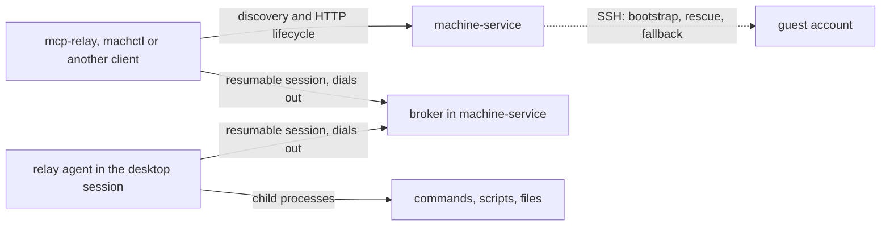

# Relay agent (RA)

## Why

- A command sent over SSH runs in an SSH login session, not in the desktop session of the user who is logged in at the machine's display.
- macOS attributes the privacy permissions (TCC) of a command run over SSH to `/usr/libexec/sshd-keygen-wrapper`, so pilot-images writes TCC grants for that wrapper by hand (its phase 65) to keep `osascript` from hanging on a consent dialog that nobody can answer.
- macOS unlocks the login keychain per login session. On 2026-11-02, in a macOS 26 VM that had rebooted and logged in automatically, the desktop session read a stored keychain item, while the same read over SSH failed with exit status 36 because the keychain was locked in that session.
- SSH has no session resumption. A broken SSH connection loses its channels and the command's result, which is the problem the [remote session](remote-session.md) addresses for the client link.
- Machines may sit in different sites behind network address translation (NAT), where nothing can open a connection to them from outside (DC-100).
- A durable Mac already runs commands in its desktop session, because machine-service is a LaunchAgent there and starts each command as its own child ([DM-4](durable-machine.md#dm-4-exec)). The relay agent gives every machine that property.

## RA-1: Roles

- The relay agent is a small daemon that runs in the desktop session of every machine that serves actions: macOS virtual machines, durable Macs and Ubuntu virtual machines (DC-98).
- The relay agent carries actions only: commands, scripts and file transfers.
- machine-service keeps discovery, the virtual machine lifecycle, leases, credential packs and the HTTP API (DC-99).
- The broker is a part of machine-service. It accepts connections from relay agents and from clients, and it routes each client's operations to the relay agent of the client's lease ([BK](broker.md)).
- Every connection that carries actions follows the [transport contract](transport-contract.md).
- SSH stays for bootstrap and rescue, and as a fallback link when a relay agent does not register ([RA-8](#ra-8-fallback)).

## RA-2: Where the relay agent runs

- On macOS, the relay agent is a per-user LaunchAgent with `LimitLoadToSessionType` set to `Aqua`, so launchd starts it in the desktop session of the user who logs in automatically and keeps it running with `KeepAlive`.
- On Ubuntu, the relay agent is a systemd user service that is wanted by `graphical-session.target`, so it starts in the desktop session of the user who logs in automatically.
- On a durable Mac, the relay agent is a LaunchAgent of the operator's account, and it replaces machine-service's own in-session exec of [DM-4](durable-machine.md#dm-4-exec). Every command of a durable lease on it, machine-service's own or a relay client's, gets the lease's working directory, session environment and agent keys from machine-service rather than the agent's own environment: machine-service writes them into the job's `env` FIFO itself and gives the agent only the FIFOs' paths ([RA-10](#ra-10-a-command-is-a-launchd-job-on-macos), DC-312). Each instance with exposure on has its own, named by the instance's state folder, which the daemon brings up at startup ([IN-3](installation.md#in-3-the-durable-macs-relay-agent), DC-213).
- Every action runs in the desktop session: the unlocked login keychain, the window server, and the session bus on Ubuntu.
- On macOS an action is a launchd job of its own in the user's GUI domain, never a child of the relay agent ([RA-10](#ra-10-a-command-is-a-launchd-job-on-macos), DC-310). On Ubuntu it is the agent's child in a systemd scope of its own (RA-5).
- The relay agent holds no privacy permissions and asks for none, and nothing grants it any. A task that needs a permission arranges it itself (DC-309).
- The relay agent never listens on a network port.

## RA-3: The relay agent dials out

- The relay agent opens an outgoing WebSocket connection over TLS to the broker URL in its configuration, and it keeps that connection open.
- The relay agent and the broker run the resumable session of [RS](remote-session.md): sequence numbers, acknowledgements, a replay buffer, heartbeats and a grace period.
- After a lost connection, the relay agent reconnects with exponential backoff from 250 ms to 5 s with random jitter, and it resumes its session.
- A relay agent that finds its session expired starts a new session and reports the execution IDs that it had in flight, with their outcomes when it has them.
- `relay-agent run` dials the `broker_url` of `~/.config/relay-agent/config.json` as role `agent` with its `agent_credential`, trusting the public roots and the configuration's `broker_ca_pem`. `RELAY_AGENT_ROOT`, when set, replaces `~` for the agent's own files, its configuration and its records, and leaves `HOME` to its commands; a durable Mac's second instance runs its agent so (DC-213). It resolves the broker's host name on every attempt and reads the file again before every dial, so a rotated credential or a moved broker takes effect without a restart. `RELAY_AGENT_CA_BUNDLE` adds a PEM file of authorities and `RELAY_AGENT_RESOLVE` one `host:port:address` resolution, for a test rig's name and edge (DC-150).

## RA-4: Identity and authorization

- Each relay agent holds an agent credential, which is a bearer token that the broker checks in the session's first message.
- A virtual machine's relay agent gets a new agent credential for each lease, which machine-service generates at acquisition and writes into the clone during bootstrap ([RA-7](#ra-7-bootstrap)).
- A durable Mac's relay agent holds one agent credential per machine, which the instance writes into the agent's configuration and the operator can rotate. It outlives every lease.
- A client authenticates with the lease credential that the acquisition returns, and the broker routes a client only to the relay agent of that lease.
- A lease's credentials last as long as the lease is current: until the end of its TTL plus a grace that is the instance's reclamation grace bounded by the TTL itself, which a renewal moves, and at the latest until release or reclamation revokes them ([RP-3](relay-protocol.md#rp-3-roles-and-credentials), DC-214).
- The broker refuses an agent credential or a lease credential after release, after expiry, or after rotation.
- Every credential travels inside the protocol over TLS, and none depends on a client certificate, because a proxy may end TLS on the way ([TC-5](transport-contract.md#tc-5-tls-may-end-in-the-middle)).

## RA-5: Operations

- The relay agent serves `exec`, `script`, `write`, `read`, `cancel` and `status`, with the semantics of the [guest session agent](guest-session.md#gs-3-the-guest-session-agent): a command line runs through the user's shell, a script runs on standard input, bytes are checked by SHA-256 before a command starts or a file is renamed into place, and each command runs in its own process group.
- Every operation carries the client's execution ID. The relay agent records each execution ID with its outcome, and it never runs an execution ID twice, so a broker that resends after a reconnect cannot cause a second run.
- Each record names the lease of the call that made it, which the broker sets. A record, with the command output it keeps for a replay, lives until machine-service purges its lease at release: a durable release waits for the agent to confirm the `purge`, and a virtual machine's records go with the VM. A durable purge the agent could not confirm at release is sent again each time the agent registers (DC-177). A record whose purge never came is removed 7 days after it completed (DC-173, [RP-14](relay-protocol.md#rp-14-records-belong-to-their-lease)).
- Data is sent in chunks of at most 1 MiB ([TC-8](transport-contract.md#tc-8-a-message-may-be-limited-in-size)).
- An upload is a stream into a spool named by its execution ID: the hidden sibling of a file's destination, a folder's tar stream beside the folder, or a command's standard input in the agent's state folder, with a record under `~/.local/state/relay-agent/uploads/`. The spool outlives the session that carried it, so after any loss the sender asks for the agent's committed offset with `resume` and continues there; the SHA-256 of the whole stream and the rename at the end stay the commit point. The agent reports an upload's committed offset with `progress`, flushes its spool at least every 64 MiB and when its session ends, and drops a spool nobody continued within 24 hours ([RP-15](relay-protocol.md#rp-15-resumable-streams)).
- The operating system owns the commands, so their ownership does not depend on the relay agent staying alive (DC-139):
  - On Linux, each command runs in a transient systemd user scope of its own, `relay-agent-<SHA-256 of the execution ID>-<unique suffix>.scope`, started with `systemd-run --user --scope`, which executes the shell in place. The scope is a cgroup that holds every process the command starts, a daemon that double-forks out of the process group included, and it outlives the agent. The record names the scope before the command starts (DC-167).
  - On macOS, each command is a launchd job of its own ([RA-10](#ra-10-a-command-is-a-launchd-job-on-macos)), and the record names its label before the job is registered. launchd owns the job and every process it starts.
  - On a Linux machine whose user manager takes no scopes, each command leads its own process group, and the record keeps the group with the start time that the operating system reports for its leader (DC-168). The agent proves at start that the user manager takes a scope, and otherwise logs why it uses groups; `status` names the ownership in effect.
  - A timeout, a cancel and the agent's own stop end the command: `launchctl bootout` of its job on macOS, and its group and, when it has one, its scope on Linux.
  - A relay agent that starts after another stopped while commands ran, such as after a crash, stops what each of those commands left: the job by its label, the scope by name, the group only while its leader still has the recorded start time, so a process that reused the ID is never signalled. Each such execution is then `interrupted`, and its message says what was stopped.
  - A process that leaves its group escapes the Linux group rule; the lease boundary stops it: a VM is deleted at release, and a durable Mac sweeps leftover processes ([HY](hygiene.md)).

## RA-6: Delivery and update

- pilot-images ships a pinned build of the relay agent in every image, with its LaunchAgent or systemd user unit ([pilot-images: relay agent](https://github.com/WeZZard/pilot-images/blob/main/docs/relay-agent.md)).
- The relay agent reports the SHA-256 of its executable in its first message and, from protocol 3, its own code signature: what `codesign` shows of the executable it runs from, on macOS (`signing`, [RP-4](relay-protocol.md#rp-4-relay-messages)).
- When that hash differs from the build that machine-service holds, machine-service replaces the build and restarts the relay agent. At bootstrap it does so over SSH ([RA-7](#ra-7-bootstrap)). On a `relay` lease that lives on, it does so through the relay whenever the agent registers with another build, such as after machine-service itself was upgraded and restarted (DC-171, DC-172):
  1. It writes its build over `~/.local/libexec/relay-agent/relay-agent` with `write`, atomically; the running agent keeps its own file until it restarts.
  2. It waits until no call of the lease is out, then holds new calls back and sends `restart`. The relay agent takes it only while nothing runs (otherwise `busy`, and machine-service waits and asks again), records it, answers, and executes its own path again in the same process, so launchd and systemd see no exit and the new build runs.
  3. The agent's next session says hello with the new build; the held calls go to it, and the lease record's `relay_agent.build` is updated. No execution is lost: none runs at the restart, and the records outlive it. A replacement that fails is logged and is not tried again for the same build.
- Signing never downgrades (DC-232). machine-service never replaces a relay agent signed with Developer ID by a build that is not, so a Mac that trusts a team never runs an agent that the team did not sign (DC-313); ad hoc by ad hoc, and ad hoc or unsigned by Developer ID, are allowed. It reads the signature of the build it holds with the host's `codesign` (a Linux build is unsigned), and the agent's as follows:
  - At bootstrap, when the guest has another build, it runs `/usr/bin/codesign -d -r-` on the guest's executable over SSH: macOS's only system `codesign`, never one found on the guest's `PATH`, which the guest's account controls (DC-239). A guest without `/usr/bin/codesign` is a Linux guest, whose agent is unsigned; a macOS guest without it cannot tell, and is refused too. A refused replacement serves the lease over SSH with the reason in `link_reason` (RA-8), and the guest's agent is left as it is.
  - On a lease that lives on, it takes the signature from the agent's hello; an agent of an earlier protocol on macOS is asked with `/usr/bin/codesign -d -r-` through the relay. A refused replacement is logged and not tried again for the same build, and the lease keeps the agent it has.
  - The lease record's `relay_agent.signing` names the kind of the agent's signature, from its hello.
- A durable Mac's relay agent is its instance's to replace, at startup or installation, not the lease's. The same two rules hold there ([IN-3](installation.md#in-3-the-durable-macs-relay-agent)): the release must be signed by the Developer ID team that the Mac trusts, which is the first team it installed a relay agent from unless the operator set `MACHINE_SERVICE_RELAY_AGENT_TEAM_ID` (DC-231), and the agent in place is never replaced by a build that downgrades its signing (DC-232).
- machine-service holds the relay agent's release beside itself, `relay-agent-release/` ([IN-1](installation.md#in-1-one-layout)), and sends a guest exactly the executable of the archive for the guest's platform, after checking the archive against `SHA256SUMS`; it never builds one (DC-140). A release that does not check out serves the lease over SSH with the reason (RA-8). `MACHINE_SERVICE_RELAY_AGENT_RELEASE` names another release folder.
- One trust check holds for every path (DC-236). The daemon checks the release it holds against the instance's trust exactly as the installer checks a release ([IN-2](installation.md#in-2-install-into-a-folder), [IN-3](installation.md#in-3-the-durable-macs-relay-agent)): its macOS executable signed with the identifier, with Developer ID by the team the Mac trusts, or, for a pre-release only, ad hoc, and a `SIGNING.json` that agrees. It checks at startup, whatever the instance offers, so a Tart-only instance with durable exposure off, which the installer never checks, is held to it too; and again before every upload at bootstrap and every replacement on a lease that lives on, so the release in place when a build is sent is the one checked. Every platform's build is read with the `SHA256SUMS` that check read.
  - A release that fails is never sent, whatever the guest's platform: every new lease is served over SSH with the reason in `link_reason` (RA-8), before anything is read from the guest, and a lease that lives on keeps the agent it has. A durable Mac's calls stay in the service's session (DM-4).
  - Before any trust record, the first Developer ID release the daemon checks is trusted and its team recorded, as an installation records it, so every path pins the same team (DC-237).
  - `/health` shows the last check as `relay_agent_release`: `{"trusted": true, "version", "signing": "developer-id" | "adhoc"}`, or `{"trusted": false, "reason"}`; `null` without the relay link. A reason that leaves the daemon, in `/health` or `link_reason`, names every team by its fingerprint, never by its ID (DC-238).
- Every instance with durable exposure on brings the release's relay agent and its LaunchAgent up on its Mac, from the daemon at startup and from the installer ([IN-3](installation.md#in-3-the-durable-macs-relay-agent)). Both load, unload and inspect the job with `/bin/launchctl`, macOS's only system `launchctl`, never one found on `PATH`, which whoever controls the service's environment controls (DC-242).
- A release tag `v<version>` publishes the relay agent's archives with the GitHub release: `relay-agent-<version>-<platform>.tar.gz` for `darwin-arm64`, `linux-arm64` and `linux-x86_64`, each holding the one executable `relay-agent`, and `SHA256SUMS` over them. `rust/scripts/build-relay-agent.sh` builds them; the Linux executables are static (musl), so one build serves every distribution.
- The macOS executable is signed with the identifier `com.wezzard.relay-agent`, the LaunchAgent's label, not with the per-build identifier that the linker gives it. A release is signed with Developer ID by the owner, on the owner's Mac, before it is published; its designated requirement names the identifier and the team, which the installer and the daemon trust. Only a pre-release may be signed ad hoc. No privacy permission is granted to the agent, in an image or on a durable Mac (DC-309, DC-313, [signing](../signing.md)).

## RA-7: Bootstrap

- machine-service still bootstraps a new clone over SSH with the per-lease SSH key, as [per-lease SSH keys](../lease-ssh-keys.md) describe.
- During bootstrap, machine-service writes the broker URL and the lease's agent credential into a file that only the guest user can read, and it restarts the relay agent. In order, over the lease's SSH key, with `MACHINE_SERVICE_GUEST_LINK=relay`:
  1. It reads the SHA-256 of `~/.local/libexec/relay-agent/relay-agent`, and uploads its own build there, atomically, when the guest has none or another one. When the guest has another one, it first reads that one's signature, and a replacement that would downgrade it serves the lease over SSH instead ([RA-6](#ra-6-delivery-and-update), DC-232).
  2. It writes `~/.config/relay-agent/config.json`, mode 600 in a mode-700 folder: `broker_url`, `agent_credential` and `broker_ca_pem`.
  3. It starts the relay agent in the desktop session. On macOS it installs the LaunchAgent `com.wezzard.relay-agent` (`RunAtLoad`, `KeepAlive`, `LimitLoadToSessionType` `Aqua`) when the image has none, waits for the user's `gui/<uid>` launchd domain, and bootstraps the job there, or restarts it with `launchctl kickstart -k` when it is loaded, always with `/bin/launchctl` (DC-242). This runs as the guest user and needs no root. On Ubuntu it installs the systemd user unit `relay-agent.service`, wanted by and part of `graphical-session.target`, when the image has none, enables it, waits for that target, and starts it, or restarts an agent that was already running.
- An acquisition reaches `running` only after the relay agent has registered with the broker, within `MACHINE_SERVICE_RELAY_REGISTER_TIMEOUT` (120 s by default), and has answered a probe command (`echo`) and a checksummed transfer (64 KiB written and read back).
- After bootstrap, no action uses SSH. The relay acceptance suite turns sshd off after acquisition, before the first action, to prove that ([TL-7](test-layers.md#tl-7-relay-acceptance)).

## RA-8: Fallback

- When a virtual machine's relay agent does not register within its bound, or the release machine-service holds fails its trust check ([RA-6](#ra-6-delivery-and-update)), machine-service serves the lease over the SSH link and records `link: ssh-fallback` in the lease record, with the reason in `link_reason`; it revokes the lease's relay credentials, and the acquisition's answer carries no `relay`. A lease whose relay agent registered records `link: relay` and `relay_agent` (`os`, `arch`, `build`, `broker_url`).
- A client sees the fallback in the lease record, because an action over SSH runs outside the desktop session.
- A durable Mac whose relay agent does not register falls back to machine-service's own in-session exec, which runs in the desktop session. Each durable call chooses: the relay agent when the instance runs the broker, the agent has a session and its build is the installed release's; otherwise the service's session. The answer carries `link` (`relay` or `in-session`) and, for the fallback, `link_reason`; the acquisition's answer says which link the lease's calls take at that moment ([DM-4](durable-machine.md#dm-4-exec)).

## RA-9: Relation to the guest session

- The relay agent grows from the `guest-session` crate and keeps its frames, its checksums and its process-group rules.
- The guest session's two channels, SSH stdio and Tart exec, start the agent outside the desktop session. The relay agent replaces both channels for actions.

## RA-10: A command is a launchd job on macOS

- Each `exec` or `script` runs as a launchd job of its own in the GUI domain of the agent's user, `gui/<uid>`, labelled `com.wezzard.relay-agent.job.<agent>.<SHA-256 of the execution ID>` (DC-310).
- The job's first program is the user's shell, because macOS charges a privacy request to the first program that launchd starts for a job, even after that program executes another; a launcher in front of the shell would be charged for every command (measured 2026-11-10, DC-312).
- **The FIFOs.** One set per job, mode 600, removed when the job ends: `env`, `in`, `out` and `status`. The agent opens `out` for reading and writing, and `in` for writing, before it registers the job, because launchd opens a job's standard input and output when it starts it, and opening a FIFO waits for its peer (measured on macOS 26: a script on standard input hung otherwise).
- **The prelude.** The shell's argument is a fixed prelude that sources `env` once, which sets the environment, the working directory and the command, and then runs the command as `$SHELL -c <command>`, its own child, named by the shell's file name, as `sshd` runs a remote command (GS-3). It writes the command's exit status to `status` and exits with it. Neither the job's plist nor `launchctl print` holds a value from `env`.
- **Who writes `env`.** On a virtual machine, the agent writes it with the agent's own environment, as a child of the agent had before. On a durable Mac, machine-service creates the FIFO set in the lease's state folder and writes `env` itself, with the session environment and the loaded agent keys, and the call names only the FIFOs; so no key travels in a relay message, the broker's records or the agent's records (DC-166, DC-312).
- **Redaction.** On a durable Mac with loaded agent keys, the job writes to a raw output FIFO that machine-service reads; machine-service replaces every key's value with `[redacted]`, a value split between two reads included, and writes the result to `out` (DC-221's rule, kept outside the agent). The agent reads `out`, records it and streams it.
- **Exit status.** The status is the one the prelude wrote. A signal reads as 128 plus its number, as a shell reports it, so `exit 143` and SIGTERM look alike. A job the agent stopped is `cancelled` or `timed_out`. A job that ended without writing a status, killed from outside, is reported with `launchctl print`'s last exit code or terminating signal as a best effort; its output is not an interface (`man launchctl`).
- **Stopping and owning.** Every job sets `AbandonProcessGroup`, so a process that a command leaves in the background, such as a server started with `nohup … &`, outlives the command, as it did before, until the lease's release sweeps it (HY-3); by default launchd kills them when the job's shell exits (measured). A timeout, a cancel and the agent's stop therefore kill the job's process group, which the prelude reports before it reads `env`, and then run `launchctl bootout`, which on its own ends only the job's shell (measured). The record keeps the label and the group. The shell leads the job's process group; its session is launchd's, and its parent is launchd (measured), so ownership and the release sweep go by the recorded label and process group, never by session or parentage (HY-3).
- **Failures that must not hang.** A job whose registration fails is reported at once. If the shell never opens `env` within 10 s, the agent boots the job out and reports it. Output ends when the job has exited and `out` has been drained, not at end-of-file, because a background process may keep `out` open (measured).
- A job costs about 30 ms to register, run and remove (measured 2026-11-10), which AC-70 reports.
