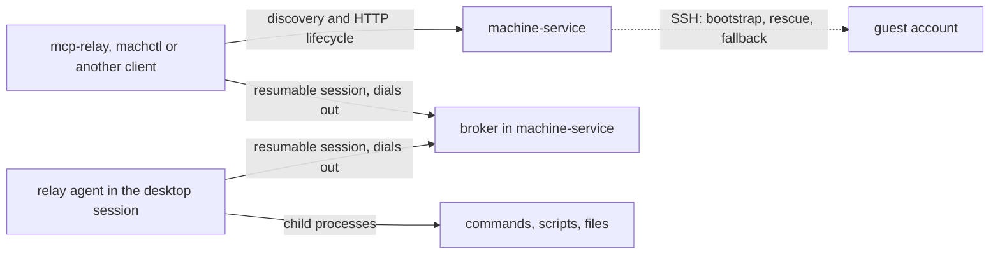

# Relay agent (RA)

## Why

- A command sent over SSH runs in an SSH login session, not in the desktop session of the user who is logged in at the machine's display.
- macOS attributes the privacy permissions (TCC) of a command run over SSH to `/usr/libexec/sshd-keygen-wrapper`, so pilot-images writes TCC grants for that wrapper by hand (its phase 65) to keep `osascript` from hanging on a consent dialog that nobody can answer.
- macOS unlocks the login keychain per login session. On 2026-11-02, in a macOS 26 VM that had rebooted and logged in automatically, the desktop session read a stored keychain item, while the same read over SSH failed with exit status 36 because the keychain was locked in that session.
- SSH has no session resumption. A broken SSH connection loses its channels and the command's result, which is the problem the [remote session](remote-session.md) addresses for the client link.
- Machines may sit in different sites behind network address translation (NAT), where nothing can open a connection to them from outside (DC-100).
- A durable Mac already runs commands in its desktop session, because machine-service is a LaunchAgent there and starts each command as its own child ([DM-4](durable-machine.md#dm-4-exec)). The relay agent gives every machine that property.

## RA-1: Roles

- The relay agent is a small daemon that runs in the desktop session of every machine that serves actions: macOS virtual machines, durable Macs and Ubuntu virtual machines (DC-98).
- The relay agent carries actions only: commands, scripts and file transfers.
- machine-service keeps discovery, the virtual machine lifecycle, leases, credential packs and the HTTP API (DC-99).
- The broker is a part of machine-service. It accepts connections from relay agents and from clients, and it routes each client's operations to the relay agent of the client's lease ([BK](broker.md)).
- Every connection that carries actions follows the [transport contract](transport-contract.md).
- SSH stays for bootstrap and rescue, and as a fallback link when a relay agent does not register ([RA-8](#ra-8-fallback)).

## RA-2: Where the relay agent runs

- On macOS, the relay agent is a per-user LaunchAgent with `LimitLoadToSessionType` set to `Aqua`, so launchd starts it in the desktop session of the user who logs in automatically and keeps it running with `KeepAlive`.
- On Ubuntu, the relay agent is a systemd user service that is wanted by `graphical-session.target`, so it starts in the desktop session of the user who logs in automatically.
- On a durable Mac, the relay agent is a LaunchAgent of the operator's account, and it replaces machine-service's own in-session exec of [DM-4](durable-machine.md#dm-4-exec).
- Every action runs as a child process of the relay agent, so it inherits the desktop session: the unlocked login keychain, the window server, the session bus on Ubuntu, and the environment that launchd or systemd gives the session.
- macOS attributes the TCC permissions of an action to the relay agent's signed executable, so the image grants permissions to the relay agent once instead of to `sshd-keygen-wrapper`.
- The relay agent never listens on a network port.

## RA-3: The relay agent dials out

- The relay agent opens an outgoing WebSocket connection over TLS to the broker URL in its configuration, and it keeps that connection open.
- The relay agent and the broker run the resumable session of [RS](remote-session.md): sequence numbers, acknowledgements, a replay buffer, heartbeats and a grace period.
- After a lost connection, the relay agent reconnects with exponential backoff from 250 ms to 5 s with random jitter, and it resumes its session.
- A relay agent that finds its session expired starts a new session and reports the execution IDs that it had in flight, with their outcomes when it has them.

## RA-4: Identity and authorization

- Each relay agent holds an agent credential, which is a bearer token that the broker checks in the session's first message.
- A virtual machine's relay agent gets a new agent credential for each lease, which machine-service generates at acquisition and writes into the clone during bootstrap ([RA-7](#ra-7-bootstrap)).
- A durable Mac's relay agent holds one agent credential per machine, which the installer writes and the operator can rotate.
- A client authenticates with the lease credential that the acquisition returns, and the broker routes a client only to the relay agent of that lease.
- The broker refuses an agent credential or a lease credential after release, after expiry, or after rotation.
- Every credential travels inside the protocol over TLS, and none depends on a client certificate, because a proxy may end TLS on the way ([TC-5](transport-contract.md#tc-5-tls-may-end-in-the-middle)).

## RA-5: Operations

- The relay agent serves `exec`, `script`, `write`, `read`, `cancel` and `status`, with the semantics of the [guest session agent](guest-session.md#gs-3-the-guest-session-agent): a command line runs through the user's shell, a script runs on standard input, bytes are checked by SHA-256 before a command starts or a file is renamed into place, and each command runs in its own process group.
- Every operation carries the client's execution ID. The relay agent records each execution ID with its outcome, and it never runs an execution ID twice, so a broker that resends after a reconnect cannot cause a second run.
- Data is sent in chunks of at most 1 MiB ([TC-8](transport-contract.md#tc-8-a-message-may-be-limited-in-size)).

## RA-6: Delivery and update

- pilot-images ships a pinned build of the relay agent in every image, with its LaunchAgent or systemd user unit ([pilot-images: relay agent](https://github.com/WeZZard/pilot-images/blob/main/docs/relay-agent.md)).
- The relay agent reports the SHA-256 of its executable in its first message.
- When that hash differs from the build that machine-service holds, machine-service sends the new build with `write` and asks the relay agent to restart itself through launchd or systemd, as the guest session agent does today.
- The machine-service installer installs the relay agent and its LaunchAgent on a durable Mac.

## RA-7: Bootstrap

- machine-service still bootstraps a new clone over SSH with the per-lease SSH key, as [per-lease SSH keys](../lease-ssh-keys.md) describe.
- During bootstrap, machine-service writes the broker URL and the lease's agent credential into a file that only the guest user can read, and it restarts the relay agent.
- An acquisition reaches `running` only after the relay agent has registered with the broker and has answered a probe command and a checksummed transfer.
- After bootstrap, no action uses SSH. The relay acceptance suite turns sshd off after acquisition, before the first action, to prove that ([TL-7](test-layers.md#tl-7-relay-acceptance)).

## RA-8: Fallback

- When a virtual machine's relay agent does not register within its bound, machine-service serves the lease over the SSH link and records `link: ssh-fallback` in the lease record.
- A client sees the fallback in the lease record, because an action over SSH runs outside the desktop session.
- A durable Mac whose relay agent does not register falls back to machine-service's own in-session exec, which runs in the desktop session.

## RA-9: Relation to the guest session

- The relay agent grows from the `guest-session` crate and keeps its frames, its checksums and its process-group rules.
- The guest session's two channels, SSH stdio and Tart exec, start the agent outside the desktop session. The relay agent replaces both channels for actions.
