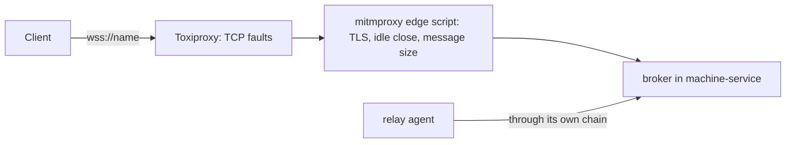

# Test layers (TL)

Each behaviour is tested on the lowest layer that contains everything the behaviour depends on. A higher layer repeats a check only when it adds something real: a real process, a real network or a real VM. Acceptance criteria are in [acceptance](../acceptance/index.md).

| Layer | Guest link (GS) | Client link (RS) | Runs in |
| --- | --- | --- | --- |
| TL-1 Unit | frames, CRC-32, the agent's request loop, client outcomes | session state machine, replay, deduplication, heartbeat timers | `cargo test --workspace` |
| TL-2 Component integration | the real agent binary as a local process; the real daemon with a fake `ssh` that runs the agent locally | the real daemon and a Rust test client through a fault proxy | `cargo test --workspace` |
| TL-3 Network lab | none | real silent packet loss, address change, an HTTPS-only proxy | test VMs with network conditioning, opt-in |
| TL-4 Live VM | both channels against macOS 26 and Ubuntu 24.04 VMs | none | second instance, `#[ignore]` |
| TL-5 End to end | Pi's traced Reminders run against the 2026-10-07 baseline | the same run with added network latency | Pi repository, opt-in |
| TL-7 Relay acceptance | the relay agent in the desktop session | the broker through the network rig | real machines, 6 cells × 4 network profiles, opt-in |

## TL-1: Unit

- Frames: encode and decode every frame type; reject a bad magic, an oversized length, a short read and every single-bit flip of the checksum's input.
- Agent loop over in-memory pipes: exec output and exit codes, a script on standard input, a timeout, `cancel`, write then read with SHA-256, a directory read answered by `is_directory`, and exit when input closes.
- Client outcomes: for each row of [GS-5](guest-session.md#gs-5-failure-outcomes-at-most-once), a scripted fake stream that fails at that point produces exactly the outcome in the table, and the number of requests sent is counted.
- Remote session state machine: a randomized test drops, duplicates and delays envelopes, cuts connections at random points and resumes. Every call completes exactly once or is reported uncertain, and no operation runs twice.

## TL-2: Component integration

- Guest link: the `guest-session` crate's tests start the real `guest-session-agent` binary as a child process and drive it through the client. Faults: kill the agent during an exec, flip a byte in its output stream, and move a 64 MiB file each way.
- Guest link through the daemon: the `vm-service` tests start the real daemon with a fake `ssh` that runs its remote command locally, with `HOME` set to a temporary guest root. The daemon uploads the agent, opens one session and serves many execs, pushes and pulls over it. The fake `ssh` counts how many connections were opened.
- Client link: the `vm-service` tests start the real daemon and connect a Rust test client through an in-process fault proxy. Faults: reset, a silent hang that keeps the connection open, latency and jitter, a reconnect from a new source port, and a daemon restart.

- Machine identity (AC-50 to AC-54): real daemon processes use separate ports, state directories and configuration directories. `MACHINE_SERVICE_NAME_FILE` supplies the name, and `MACHINE_SERVICE_NAME_POLL_MS=50` makes the same observation path run every 50 milliseconds. Tests edit the file without changing the Mac's host name. `MACHINE_SERVICE_DISCOVERY_SCOPE=local-only` confines both Bonjour advertisement and client browsing to this Mac. Tests of a single local listing use `machctl list --local`; Consul tests use their own loopback registrar fixture. Durable fixtures use the existing debug-only `MACHINE_SERVICE_DURABLE_LOCK_DIR` to isolate their lock.

## TL-3: Network lab

- The lab runs in test VMs leased from vm-service, where the test has root. The client runs in one VM and the daemon's remote session listener runs in another, so the faults sit on a real network path between them.
- macOS VMs condition the network with the system's packet filter and traffic shaper (`pfctl` and `dnctl`, the mechanism under Network Link Conditioner): delay, loss, and a silent drop of all packets. Linux VMs use `tc netem` and `iptables`.
- An address change moves the client VM to another address during a session. An HTTPS-only path is a proxy in a VM that allows only `CONNECT` to port 443.
- The lab holds at most one macOS VM at a time, because a host runs at most two macOS guests and other work shares them. Faults that need no macOS behaviour run in Linux VMs.
- An agent runs the lab's test plan and records results and timings under `test-evidence/`.

## TL-4: Live VM

- Live tests are `#[ignore]` with a reason, as `rust/CONVENTIONS.md` requires. They run against second instances built from the worktree, each on its own port and state directory, and send commands directly to their own test VMs.
- Two instances run at once, one per guest link (6250 for the session link, 6251 for `ssh`), so a parity case compares two leases of one image without restarting a daemon. `rust/scripts/live-instance.sh` starts each instance in its own session: stopping the shell that started it must not signal the `tart run` processes of its VMs.
- Every live test checks that the installed daemon on 6240 kept its process and holds no test lease (AC-18).
- The conformance suite runs the same cases over the SSH stdio channel and the Tart exec channel, on a macOS 26 image and an Ubuntu 24.04 image with the Tart guest agent installed.
- Cases: exec parity with the current `ssh` link (output, exit code, `PATH`, user and home); a 64 MiB output and file each way with matching SHA-256; the guest network turned off during a session; a VM restart and a stale Tart control socket; release during a running command; round-trip time per operation.
- The report records each case's result and timings per channel, image and Tart version under `test-evidence/`, which is ignored by git.

## TL-5: End to end

- Pi's traced Reminders run (`PI_SECRETARY_VM_USE_TRACE`) is repeated with mcp-vm-relay on the new links. Its step intervals are compared with the 2026-10-07 baseline of a 4.37 s mean between actions, with and without added latency on the client link.
- Each step interval is split into the model's time, the guest's own work and the transport's time. Only the transport's time is in scope; the model's time and the guest's work set the floor.
- The work is done when the transport's time is the smallest of the three parts, both without and with added latency on the client link. The run's report states the floor, so the result is read against what the system can reach rather than against a guessed number.

## TL-6: Live durable machine

- Durable-machine behaviour that needs a real Mac is tested on the Mac itself, with a second instance on another port, with its own state and configuration folders and with durable exposure turned on, as TL-4 does for VMs. Its configuration folder holds test agent keys and a test `endpoints.json`.
- On 192.0.2.3 the installed instance keeps exposure off (DC-39), so the durable lease is proved there only through second instances (DC-40). On 192.0.2.4 and 192.0.2.5 the installed instance exposes the Mac.
- Every instance on a Mac shares the host-wide lease lock ([DM-2](durable-machine.md#dm-2-one-lease-at-a-time)), so two second instances prove the lock across instances, and a live test on a mini can never lease the Mac while the installed instance holds it, or the other way round.
- Cases: an acquisition while the machine is leased; exec in the GUI session with the expected `PATH` and no owner credential variables; the agent keys reaching Claude Code and Codex without appearing in any response or log; a leftover application and a leftover background process swept at release while a stand-in CI process survives; the inventory recording an installed Homebrew formula; and a release during a running command.
- The CLI's federated list runs against the real Consul agent and lists every registered instance, including one that is stopped for the test.
- TL-6 never pauses the CI runner and never changes the installed instance, as AC-18 requires.

## TL-7: Relay acceptance

- The relay acceptance suite is the final acceptor of the [relay agent](relay-agent.md), the [broker](broker.md) and the [transport contract](transport-contract.md) (DC-103).
- It runs on real machines with the real relay agent, the real broker and a real client, and it turns sshd off in every guest after acquisition and before the first action.
- It does not test SSH.

### The network rig

- Every connection between a client and the broker, and between a relay agent and the broker, passes through a chain of two proxies (DC-104).
- The first proxy is Toxiproxy, which injects faults at the TCP level: latency with jitter, a bandwidth limit, a blackhole (`timeout`), a reset (`reset_peer`), a close after a number of bytes (`limit_data`) and fragmentation (`slicer`).
- The second proxy is mitmproxy with an edge script in this repository, which ends TLS and opens a new TLS connection, closes a WebSocket that is idle for 100 seconds, and closes a connection that sends a WebSocket message larger than 1 MiB.
- Both proxies run without root on the client's machine, at pinned versions, and the broker is reachable only through the chain's one port and only by a host name.
- Faults follow a seeded schedule, so a failing run can be replayed exactly, and a test can also set a fault at an exact moment through Toxiproxy's HTTP API.

### Network profiles

| Profile | What the rig does | Why |
| --- | --- | --- |
| N0 Clean | The chain is in place and injects no fault. | It gives a baseline and the speed measurement. |
| N1 Edge | It enforces TC-1, TC-3, TC-5, TC-6 and TC-8 at all times. | It behaves like a Cloudflare edge. |
| N2 Long-haul | It adds TC-7 to N1: 300 ms to 1 s of latency with jitter, a bandwidth limit and fragmentation. | It behaves like a link between continents. |
| N3 Chaos | It adds TC-2 and TC-4 to N2: random resets and blackholes and address changes on a seeded schedule. | It imposes the worst case of the contract. |

### Cells

- The suite runs in 6 cells: a client on macOS or on Ubuntu, against a macOS virtual machine, a durable Mac or an Ubuntu virtual machine.
- Each cell runs under the 4 profiles, so a full acceptance is 24 runs of the suite.
- AC-55 to AC-60, AC-66 and AC-68 run under every profile.
- AC-61 to AC-65, AC-67 and AC-69 run under N1, N2 and N3.
- AC-70 measures speed under N0 and N2.

### Coverage of the contract

| Rule | Proven by | The suite fails when |
| --- | --- | --- |
| TC-1 | every scenario under N1 to N3 | the stack uses another port, UDP or an inbound connection |
| TC-2 | AC-61, AC-64 and N3 | an operation runs twice or a result is lost |
| TC-3 | AC-69 | heartbeats are missing or too far apart |
| TC-4 | AC-63 and N3 | a session is tied to an address or a connection |
| TC-5 | AC-66 under N1 to N3 | a credential depends on a client certificate |
| TC-6 | AC-68 under N1 to N3 | discovery or a client needs an IP address |
| TC-7 | AC-56 to AC-59 under N2 and N3 | a timeout assumes a fast link |
| TC-8 | AC-57 and AC-58 under N1 to N3 | data is sent in a message larger than 1 MiB |
