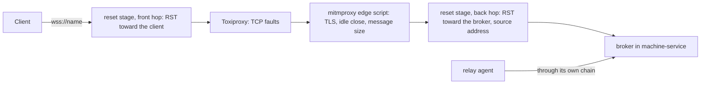

# Test layers (TL)

Each behaviour is tested on the lowest layer that contains everything the behaviour depends on. A higher layer repeats a check only when it adds something real: a real process, a real network or a real VM. Acceptance criteria are in [acceptance](../acceptance/index.md).

| Layer | Guest link (GS) | Client link (RS) | Runs in |
| --- | --- | --- | --- |
| TL-1 Unit | frames, CRC-32, the agent's request loop, client outcomes | session state machine, replay, deduplication, heartbeat timers | `cargo test --workspace` |
| TL-2 Component integration | the real agent binary as a local process; the real daemon with a fake `ssh` that runs the agent locally | the real daemon and a Rust test client through a fault proxy | `cargo test --workspace` |
| TL-3 Network lab | none | real silent packet loss, address change, an HTTPS-only proxy | test VMs with network conditioning, opt-in |
| TL-4 Live VM | both channels against macOS 26 and Ubuntu 24.04 VMs | none | second instance, `#[ignore]` |
| TL-5 End to end | Pi's traced Reminders run against the 2026-10-07 baseline | the same run with added network latency | Pi repository, opt-in |
| TL-7 Relay acceptance | the relay agent in the desktop session | the broker through the network rig | real machines, 6 cells × 4 network profiles, opt-in |

## TL-1: Unit

- Frames: encode and decode every frame type; reject a bad magic, an oversized length, a short read and every single-bit flip of the checksum's input.
- Agent loop over in-memory pipes: exec output and exit codes, a script on standard input, a timeout, `cancel`, write then read with SHA-256, a directory read answered by `is_directory`, and exit when input closes.
- Client outcomes: for each row of [GS-5](guest-session.md#gs-5-failure-outcomes-at-most-once), a scripted fake stream that fails at that point produces exactly the outcome in the table, and the number of requests sent is counted.
- Remote session state machine: a randomized test drops, duplicates and delays envelopes, cuts connections at random points and resumes. Every call completes exactly once or is reported uncertain, and no operation runs twice.

## TL-2: Component integration

- Guest link: the `guest-session` crate's tests start the real `guest-session-agent` binary as a child process and drive it through the client. Faults: kill the agent during an exec, flip a byte in its output stream, and move a 64 MiB file each way.
- Guest link through the daemon: the `vm-service` tests start the real daemon with a fake `ssh` that runs its remote command locally, with `HOME` set to a temporary guest root. The daemon uploads the agent, opens one session and serves many execs, pushes and pulls over it. The fake `ssh` counts how many connections were opened.
- Client link: the `vm-service` tests start the real daemon and connect a Rust test client through an in-process fault proxy. Faults: reset, a silent hang that keeps the connection open, latency and jitter, a bandwidth cap, both directions through one queue, a reconnect from a new source port, and a daemon restart. The bandwidth cap paces each forwarding loop on one schedule across its writes, so the link carries its cap even where the host's sleeps overshoot (DC-303).

- Relay link fallback (RA-8): the real daemon with the relay link and no relay agent at all serves the lease over SSH. The acquisition's answer and the lease record say `link: ssh-fallback` with the reason, the answer carries no `relay`, the agent credential bootstrap wrote into the fake guest is refused, and exec, a script, push and pull work over SSH. A durable lease without its agent runs in the service's session and says why.
- The durable Mac's own relay agent (IN-3): a second instance with exposure on and the relay link, given a `launchctl` that runs the LaunchAgents it loads through the test build's seam, never `PATH` (DC-242), brings its own agent up, under the label and root its state folder names, and the agent registers and serves the lease with the operator's `HOME`; a restart of the instance leaves it alone.
- Credential lifetime (RP-3): the broker refuses a credential past the end its lease gave it and accepts it again when a renewal moves the end; the end is the TTL's plus the instance's grace bounded by the TTL.
- Machine identity (AC-50 to AC-54): real daemon processes use separate ports, state directories and configuration directories. `MACHINE_SERVICE_NAME_FILE` supplies the name, and `MACHINE_SERVICE_NAME_POLL_MS=50` makes the same observation path run every 50 milliseconds. Tests edit the file without changing the Mac's host name. The test build's DNS-SD folder (`MACHINE_SERVICE_TEST_BONJOUR`) stands for Bonjour advertisement and client browsing, so every daemon binds loopback and nothing reaches mDNSResponder (DC-252). Tests of a single local listing use `machctl list --local`; Consul tests use their own loopback registrar fixture. Durable fixtures use the existing debug-only `MACHINE_SERVICE_DURABLE_LOCK_DIR` to isolate their lock.

### Isolation of a test build (DC-251 to DC-258)

Every binary that `cargo test` builds carries the test seams (`service_layout::test_build`, the feature `test-build`) and acts only on what its test owns; a release carries none of them.

- Every child a test starts (the daemon, the installer, `machctl`, the relay agent, the guest agent, stand-ins) starts through `service_layout::test_build::harness`: an empty environment except `PATH=/usr/bin:/bin:/usr/sbin:/sbin` and what the test names, a process group of its own, and a lifeline. Its handle ends its group, its descendants and the groups they lead; the last handle on a lifeline ends every process still holding it; a test build whose lifeline closes, because the test ended or was interrupted, ends its own.
- A test build refuses the installed defaults: the ports 6240 and 6241, the account's installed folders whatever `HOME` says, a bind outside loopback (durable exposure included), an inherited `VM_ENVIRONMENT_FILE`, the host-wide lease lock and the Mac's own name.
- It runs every tool from its tool table (`MACHINE_SERVICE_TEST_TOOLS`) or, without one, only the read-only system tools; a bare name never goes to `PATH`, and an installed tool outside the table is refused. Each daemon fixture's table is `tools/` beside its `bin/` of shims.
- Its release sweep sees only the processes it started and the rows of its process fixture (`MACHINE_SERVICE_TEST_PROCESSES`), whose signals it records; its running applications are the fixture's; its lease shell never reads an inherited `ZDOTDIR`.
- `isolation_guard.rs` proves it on the real daemon from a developer's environment: refused step by step until every value is owned, then loopback only, no recorder run, and nothing left behind by the handle or by a severed lifeline. `test_builds.rs` proves that a release build of the installer refuses a test build.

## TL-3: Network lab

- The lab runs in test VMs leased from vm-service, where the test has root. The client runs in one VM and the daemon's remote session listener runs in another, so the faults sit on a real network path between them.
- macOS VMs condition the network with the system's packet filter and traffic shaper (`pfctl` and `dnctl`, the mechanism under Network Link Conditioner): delay, loss, and a silent drop of all packets. Linux VMs use `tc netem` and `iptables`.
- An address change moves the client VM to another address during a session. An HTTPS-only path is a proxy in a VM that allows only `CONNECT` to port 443.
- The lab holds at most one macOS VM at a time, because a host runs at most two macOS guests and other work shares them. Faults that need no macOS behaviour run in Linux VMs.
- An agent runs the lab's test plan and records results and timings under `test-evidence/`.

## TL-4: Live VM

- Live tests are `#[ignore]` with a reason, as `rust/CONVENTIONS.md` requires. They run against second instances built from the worktree, each on its own port and state directory, and send commands directly to their own test VMs.
- Two instances run at once, one per guest link (6250 for the session link, 6251 for `ssh`), so a parity case compares two leases of one image without restarting a daemon. `rust/scripts/live-instance.sh` starts each instance through the launcher below.
- Every live test checks that the installed daemon on 6240 kept its process and holds no test lease (AC-18).

### The second-instance launcher

- Every second instance of TL-4, TL-6 and TL-7 is started by one launcher, the `second-instance` binary, which `rust/scripts/live-instance.sh` and `rust/scripts/relay-acceptance-host.sh` call (DC-243). `start` takes an explicit root, port, broker port and Tart store, and refuses ports 6240 and 6241, a root that overlaps the installed instance's state, configuration or Tart folders, and a root in a folder that others can write.
- The root holds everything the instance owns: its state and configuration folders, its own credential packs, a disabled console configuration, its logs and its manifest. The manifest is written before anything else is made, and lists the instance's ID, ports, bind address, Tart store and environment.
- The daemon gets a minimal environment: a fixed `PATH`, `HOME`, `USER`, `LOGNAME`, `TMPDIR`, `LANG`, the launcher's own settings, local-only discovery, `TART_NO_AUTO_PRUNE=1`, and only those `--env` settings that are `MACHINE_SERVICE_*` variables the launcher does not set itself, or `PILOT_REPO`. It runs in its own session, so a signal to the shell that started it never reaches the `tart run` processes of its VMs.
- Both listeners, HTTP and the broker (`MACHINE_SERVICE_SESSION_HOST`), bind one address: loopback by default, or the host's own LAN address when a TL-7 client on another machine needs it, never every interface. Durable exposure off loopback is refused unless `--durable-cell` names the durable acceptance cell that needs it, and `exposure` reports what the instance exposes, which the suite keeps in the run's evidence.
- The daemon checks the same rules itself when `MACHINE_SERVICE_SECOND_INSTANCE` is set, and reports `second_instance` in `/health` only then (DC-244). Every live client (`live_e2e`, `live_image_catalog`, `live_guest_session`, `relay-acceptance`) refuses ports 6240 and 6241 and any instance whose `/health` lacks that mark. No override exists (DC-245).
- Tart resolves a local clone source only in its own store, so a second instance cannot clone the operator's bases into a store of its own. It is given the operator's store explicitly, reads its bases, and names every clone `si-<id>-…`. Only the launcher deletes those VMs, and it deletes no others (DC-246).
- A second instance reads credential packs only from `<root>/config/vm-credentials`, never the operator's `~/.config/vm-credentials`, so a live test brings its own pack fixture (DC-247).
- `restart` restarts only the daemon, and its leases live on. `stop` releases every lease through the daemon, starting it again if it has crashed. It then stops the daemon, deletes every VM in the store that carries the prefix, unloads the relay agents under the state folder, removes the durable workspaces of the instance's leases and removes the root. The manifest goes last, and only when nothing is left, so running `stop` again finishes what an earlier run left.
- The conformance suite runs the same cases over the SSH stdio channel and the Tart exec channel, on a macOS 26 image and an Ubuntu 24.04 image with the Tart guest agent installed.
- Cases: exec parity with the current `ssh` link (output, exit code, `PATH`, user and home); a 64 MiB output and file each way with matching SHA-256; the guest network turned off during a session; a VM restart and a stale Tart control socket; release during a running command; round-trip time per operation.
- The report records each case's result and timings per channel, image and Tart version under `test-evidence/`, which is ignored by git.

## TL-5: End to end

- Pi's traced Reminders run (`PI_SECRETARY_VM_USE_TRACE`) is repeated with mcp-vm-relay on the new links. Its step intervals are compared with the 2026-10-07 baseline of a 4.37 s mean between actions, with and without added latency on the client link.
- Each step interval is split into the model's time, the guest's own work and the transport's time. Only the transport's time is in scope; the model's time and the guest's work set the floor.
- The work is done when the transport's time is the smallest of the three parts, both without and with added latency on the client link. The run's report states the floor, so the result is read against what the system can reach rather than against a guessed number.

## TL-6: Live durable machine

- Durable-machine behaviour that needs a real Mac is tested on the Mac itself, with a second instance on another port, with its own state and configuration folders and with durable exposure turned on, as TL-4 does for VMs. Every second instance that a script starts goes through the [launcher](#the-second-instance-launcher), and durable exposure stays on loopback unless a durable acceptance cell needs the LAN. A durable lease's commands, and the relay agent that runs them, keep the operator's `HOME`, because a durable lease is the operator's desktop session (DM-1). That is what TL-6 and the durable cells prove, so the suite confines what it does there instead (TL-7). Its configuration folder holds test agent keys and a test `endpoints.json`. With the relay link on, it brings up its own relay agent, under the label and root its state folder names, beside the installed instance's agent and never in place of it ([IN-3](installation.md#in-3-the-durable-macs-relay-agent)).
- On 192.0.2.3 the installed instance keeps exposure off (DC-39), so the durable lease is proved there only through second instances (DC-40). On 192.0.2.4 and 192.0.2.5 the installed instance exposes the Mac.
- Every instance on a Mac shares the host-wide lease lock ([DM-2](durable-machine.md#dm-2-one-lease-at-a-time)), so two second instances prove the lock across instances, and a live test on a mini can never lease the Mac while the installed instance holds it, or the other way round.
- Cases: an acquisition while the machine is leased; exec in the GUI session with the expected `PATH` and no owner credential variables; the agent keys reaching Claude Code and Codex without appearing in any response or log; a leftover application and a leftover background process swept at release while a stand-in CI process survives; the inventory recording an installed Homebrew formula; and a release during a running command.
- The CLI's federated list runs against the real Consul agent and lists every registered instance, including one that is stopped for the test.
- TL-6 never pauses the CI runner and never changes the installed instance, as AC-18 requires.
- One TL-6 test asks the installed instances of other Macs instead of a second instance: `machctl/tests/questions_live.rs` checks FD-7 from a Mac whose own instance offers nothing. It is read-only: it sends only `GET` requests for `/health`, `/machines`, `/images` and `/acquisition-capabilities`, it finds the instances with Bonjour at run time and names none, and its local instance is a closed loopback port (DC-282).
- Its second instances are this worktree's test builds, started with the live layer's opt-in `MACHINE_SERVICE_TEST_LIVE=TL-6`, which only its ignored tests set: with it a test build runs the system's tools, reads the Mac's name, takes the host-wide lease lock and sweeps the real session as a release does, and still refuses the installed ports and folders and any bind outside loopback (DC-253). Applications opened in the desktop session are proved only here.

## TL-7: Relay acceptance

- The relay acceptance suite is the final acceptor of the [relay agent](relay-agent.md), the [broker](broker.md) and the [transport contract](transport-contract.md) (DC-103).
- It runs on real machines with the real relay agent, the real broker and mcp-relay, the client agents use (DC-341, DC-342), and it turns sshd off in every guest after acquisition and before the first action.
- It does not test SSH.

### The network rig

- Every connection between a client and the broker, and between a relay agent and the broker, passes through a chain of two proxies (DC-104), with the rig's own reset stage at each end of the chain (DC-137).
- The first proxy is Toxiproxy, which injects faults at the TCP level: latency with jitter, a bandwidth limit, a blackhole (`timeout`), a reset (`reset_peer`), a close after a number of bytes (`limit_data`) and fragmentation (`slicer`).
- The second proxy is mitmproxy with an edge script in this repository, which ends TLS and opens a new TLS connection, closes a WebSocket that is idle for 100 seconds, and closes a connection that sends a WebSocket message larger than 1 MiB.
- The reset stage is a TCP relay in the `network-rig` crate, with one hop in front of Toxiproxy and one between mitmproxy and the broker. It cuts a chosen open connection, or every one, with a TCP RST toward the client, the broker or both, by closing that side's socket with a zero linger time. The hop's other socket closes normally, so the rest of the chain sees an ordinary close, and a reset that reaches a hop from one side is passed on as a reset to the other.
- The stage pairs a client's connection with the broker connection that the edge opens for it by the random of the client's TLS ClientHello, which the front hop reads as it passes and the edge writes to the run's `edge-pairs.jsonl` with its source port.
- The stage adds 40 to 70 µs to a round trip over loopback at the median, measured by the self-test `the_reset_stage_adds_negligible_latency` on macOS and Linux.
- Both proxies and the stage run without root on the client's machine, the proxies at pinned versions, and the broker is reachable only through the chain's one port and only by a host name.
- Faults follow a seeded schedule, so a failing run can be replayed exactly, and a test can also set a fault at an exact moment through the rig's `Control`, which drives Toxiproxy's HTTP API and the reset stage.
- The rig is the `network-rig` crate. It pins Toxiproxy 2.13.0 and mitmproxy 12.3.1 for macOS arm64 and Linux arm64 and x86_64, and fetches them into a cache outside the repository, checking each SHA-256 before use. The edge script is `rust/crates/network-rig/edge/edge.py`.
- A client is told the broker's URL, `wss://broker.relay-rig.test:<port>/relay`, the chain's port to resolve the name to, and the CA bundle of the edge's authority. It resolves the name itself, so no system setting changes. The edge answers `421` to any other name and to an address, and the broker's own certificate never reaches the client.
- The edge ends TLS under every profile, because AC-66 and AC-68 run under N0. Its idle close counts every byte in either direction, WebSocket pings included, and its message limit closes the WebSocket with code 1009; a message of exactly 1 MiB passes.
- A reset is Toxiproxy's `reset_peer`: it sends a TCP RST to every connection dialled while it is armed, and cuts an open connection without a RST when it next carries data. A cut is the stage's: an open connection receives a TCP RST at once, on the side chosen. The edge turns a reset on one of its legs into a WebSocket close with code 1000 on the other, as an edge that ends TLS does. A blackhole drops data without closing anything, and closes the connection when it ends.
- An address change closes every connection, and the broker sees each new connection come from a new source address and port on Linux, where the stage's back hop moves to the next address of `127.0.0.0/8`, which needs no root. On macOS, whose loopback has one address without root, only the source port changes. When the broker is on another machine, which a loopback source cannot reach, only the source port changes as well (DC-192). The rig records which in `rig.json` as `address_change`.
- `NETWORK_RIG_SEED` replays a seed. Each run records its profile, seed and schedule in `rig.json`, and the cell runner writes each cell's results to `report.json` under `<evidence>/<cell>/<profile>/`. Toxiproxy's latency jitter is not seeded, so a replay repeats the faults but not each packet's delay.
- The rig's self-tests are opt-in: `cargo test -p network-rig --test rig_live -- --ignored`. They drive a WebSocket echo server under TLS in place of the broker.
- A relay agent's chain runs on its target's host as `network-rig serve`, in front of the broker, and `network-rig ctl` sets its faults. Guests reach it on their host's address on the guest network (`MACHINE_SERVICE_RELAY_GUEST_PORT`), and its edge, which signs with the broker's authority that the agents trust, serves those addresses as well as its name (DC-184, DC-185).
- CI runs the self-tests on every change on Ubuntu x86_64, Ubuntu arm64 and macOS arm64, the three platforms the rig pins, and caches the pinned tools by their versions and hashes (DC-138).

### Network profiles

| Profile | What the rig does | Why |
| --- | --- | --- |
| N0 Clean | The chain is in place and injects no fault: TLS ends at the edge and the broker is reached by name, with no idle close and no message limit. | It gives a baseline and the speed measurement. |
| N1 Edge | It enforces TC-1, TC-3, TC-5, TC-6 and TC-8 at all times: an idle close at 100 seconds and a limit of 1 MiB per message. | It behaves like a Cloudflare edge. |
| N2 Long-haul | It adds TC-7 to N1: 300 ms to 1 s of latency with jitter (325 ms ± 175 ms each way), a bandwidth limit of 4096 KB/s each way and fragmentation into pieces of 256 to 1792 bytes. | It behaves like a link between continents. |
| N3 Chaos | It adds TC-2 and TC-4 to N2: random resets, cuts, blackholes, data limits and address changes on a seeded schedule, the first after 10 seconds and then one every 20 to 60 seconds after the previous one ends. | It imposes the worst case of the contract. |

The profiles are JSON files in `rust/crates/network-rig/profiles/`.

### Cells

- The suite runs in 6 cells: a client on macOS or on Ubuntu, against a macOS virtual machine, a durable Mac or an Ubuntu virtual machine.
- Each cell runs under the 4 profiles, so a full acceptance is 24 runs of the suite.
- AC-55 to AC-60, AC-66 and AC-68 run under every profile.
- AC-61 to AC-65, AC-67 and AC-69 run under N1, N2 and N3.
- AC-70 measures speed under N0 and N2.
- A run that finds no machine for its cell is missing. An acceptance with a missing run is incomplete, and is never reported as passed (DC-341).

### Running the suite

- The suite is the `relay-acceptance` crate: the matrix runner, the scenarios and an MCP client that drives mcp-relay.
- **The matrix.** `rust/crates/relay-acceptance/matrix.json` names each cell only by what it needs: the client's operating system and the target's kind (an image of a kind, or a durable Mac), and the profiles it runs under. It names no host and no address (DC-32, DC-338).
- **One command.** `relay-acceptance matrix --evidence <dir>` runs the whole matrix:
  - it finds every machine-service instance and every machine they offer, as `machctl list` does ([FD-2](federation.md#fd-2-discovery), [FD-7](federation.md#fd-7-catalog-questions-and-image-acquisition)), skipping any the operator excludes in the run's environment (`RELAY_ACCEPTANCE_EXCLUDE`);
  - it gives each run a machine that fits, starts that run's own test instance and network rig on the machine's host, and runs as many runs at once as the machines it found allow;
  - it reports each run's result, each missing run, and whether the acceptance is complete, in `<dir>/summary.json`.
- `relay-acceptance run --cell <cell> --profile <N0..N3>` still runs one run, for diagnosis, and `relay-acceptance summary <dir>` prints the matrix.
- **The client.** Each scenario acts through mcp-relay's tools (`relay_acquire`, `relay_stage`, `relay_script`, `relay_extract`, `relay_release`), which the suite calls over MCP after starting mcp-relay's server, as an agent does. mcp-relay reaches the broker through the cell's rig. A check that needs a protocol-level view, such as AC-70's round trips, reads mcp-relay's own records of the session.
- **Host control.** AC-61, AC-64 and AC-65 restart the broker or cut connections on the target's host. The runner does that through `scripts/relay-acceptance-host.sh` behind a restricted SSH key with a forced command, which one setup command authorizes on each Mac (DC-307, DC-343). A Mac without the key has those checks reported missing, never passed.
- **Test instances.** On each host, `scripts/relay-acceptance-host.sh` runs the run's second instance with the relay link through the [launcher](#the-second-instance-launcher) (`start`, `restart`, `stop`, `status`, `exposure`, `clean`), and the agents' chain (`rig-start <profile> <seed>`, `rig-stop`, `rig-ctl <request>`), each in a folder of its own, on ports the runner chooses. Its listeners bind loopback unless a client on another machine needs the host's own address.
- The agents' chain is reached by guests on their network's host address, a vmnet bridge that exists only once the first VM runs. The chain therefore listens on every interface, and `--admit guests` closes every connection that comes neither from loopback nor from a bridge's subnet, so the chain never serves the LAN (DC-248).
- With durable exposure the instance exposes its Mac and brings up its own relay agent, which dials the broker through the agents' chain on the instance's address, as a guest's agent does, so a cell can fault the agent's connection too (`MACHINE_SERVICE_RELAY_DURABLE_AGENT_PORT`, DC-327). An installed instance's agent dials its broker directly.
- The agent's LaunchAgent lies under the state folder, so launchd never loads it at a later login. The agent outlives `restart`, as the installed agent outlives a restart of its instance. `stop` unloads the agent and removes it, together with every lease and VM of the instance. The instance runs with `MACHINE_SERVICE_GRACE_HOURS=0`, so a lease and its relay credentials end at the end of its TTL, which AC-66 waits for.
- **Permission prompts.** On a macOS target, AC-55 also runs a script that sends an Apple Event, starting it in the background, and approves the permission prompt that macOS raises by pressing Return on it through cua-driver; the script must then complete. The suite's own steps approve the prompt: mcp-relay, machine-service and the relay agent never do (DC-339, DC-340). A VM's approval ends with the VM.
- **The durable Macs' checklist.** On a durable Mac an approval stays, because a durable Mac cannot be erased yet. The suite records every prompt it approves there (the Mac, the program, the permission, the app, the time), and `summary.json` ends with that checklist per durable Mac (DC-340). The checklist comes from the suite's own record; it never reads the Mac's privacy database (DC-343).
- On a durable Mac the suite otherwise touches only items it owns (DC-249). AC-55's keychain check creates, reads and deletes an item under a name of its own, and checks that the item is gone. It then checks that the command's process is not a descendant of the relay agent, by walking its parent processes. AC-64 and AC-65 restart or stop only a second instance's own relay agent, whose label carries the suffix that its state folder derives, and never the installed agent.
- A durable cell finds its agent's label and root in the lease record's `relay_agent`, because a second instance's agent is not the installed one's.
- AC-65 does not reboot a durable Mac, nor log its operator out: it is the operator's machine, its CI runner is never paused (DC-25), and a logout would end the runner too. On a durable Mac AC-65 restarts the agent's LaunchAgent job as a new desktop session starts it (`launchctl kickstart -k gui/<uid>/<label>`), and the agent must register again by itself and pass AC-55's checks (DC-216).
- AC-66's expired credential is a second lease of the shortest TTL, 0.1 hours: its credential is accepted before the end its lease gives it and refused after it. On a durable Mac, AC-60 checks that the agent credential outlives the lease instead of its refusal, because it is the machine's (RA-4).
- An Ubuntu client runs in a leased ubuntu2404 VM, which the runner leases like any other machine; it puts the static Linux build and mcp-relay in it, runs the run there and brings the evidence home.
- The lab workflow runs the cells in ephemeral runner VMs that production lends, against the run's own test environment: a second instance of the run's branch build, which the runner controller on the host that serves the run downloads, verifies against the run, starts with the launcher for the run's duration only and removes afterwards ([LR-6](lab-runners.md#lr-6-the-test-environment-of-a-run)). The cells run without host control and with `--agent-rig external` ([LR-9](lab-runners.md#lr-9-the-workflow)); a durable cell reads its test environment's exposure from `/health` (DC-273), and a durable Mac's test environment exists only during a run its owner dispatched ([LR-10](lab-runners.md#lr-10-durable-macs)). The client asks for no credential pack, since a test environment has only its own (DC-247, DC-283).
- Each scenario reports named checks. A check that waits for something not built yet or not in the images yet is `blocked`, with the reason, and is not a failure (DC-187).

### Coverage of the contract

| Rule | Proven by | The suite fails when |
| --- | --- | --- |
| TC-1 | every scenario under N1 to N3 | the stack uses another port, UDP or an inbound connection |
| TC-2 | AC-61, AC-64 and N3 | an operation runs twice or a result is lost |
| TC-3 | AC-69 | heartbeats are missing or too far apart |
| TC-4 | AC-63 and N3 | a session is tied to an address or a connection |
| TC-5 | AC-66 under N1 to N3 | a credential depends on a client certificate |
| TC-6 | AC-68 under N1 to N3 | discovery or a client needs an IP address |
| TC-7 | AC-56 to AC-59 under N2 and N3 | a timeout assumes a fast link |
| TC-8 | AC-57 and AC-58 under N1 to N3 | data is sent in a message larger than 1 MiB |
